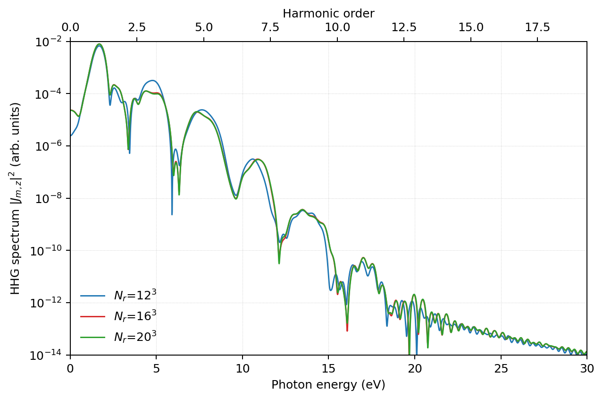
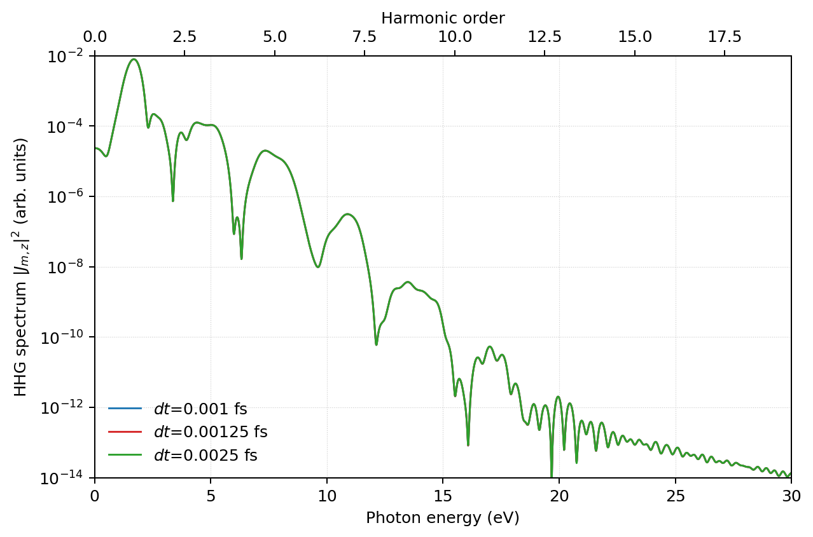
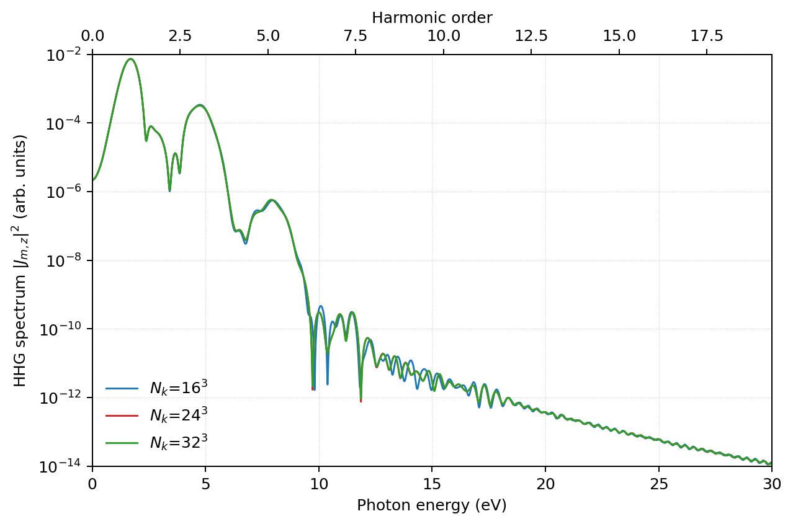

# Learning objective

Learn to establish the spatial-grid, time-step, and k-point convergence of an
HHG calculation while keeping GS and RT restart data mutually consistent.

# Summary

For a silicon high-harmonic-generation (HHG) calculation, numerical
convergence should be checked in the order real-space grid, time step, and
k-point grid. The real-space grid controls the finite-difference accuracy and
is therefore the first priority. The time step should first be screened with
short real-time runs for numerical stability, then checked with a fixed-length
HHG calculation. K-point convergence is checked last after the real-space and
time discretizations are fixed.

This campaign also demonstrated that ground-state and real-time restart data
must use identical spatial grids. A scheduler success or process exit code is
not sufficient evidence of a valid RT result; electron-number conservation and
finite physical observables must be checked explicitly.

## Context and objective

The objective was to establish a reusable convergence and validation workflow
for the bulk-Si HHG example using SALMON 2.3.0. The target observable was the
z-polarized HHG spectrum, represented by column 10 (`|Jm_z|^2`) of
`Si_pulse.data`.

## Conditions

- SALMON version or commit: 2.3.0; exact executable build commit unknown.
- Structure and model: eight-atom cubic Si cell, PZ functional, official KY
  pseudopotential, 32 electrons.
- Pulse for the convergence campaign: `ae_shape1='Acos2'`,
  `I_wcm2_1=1.0d12`, `tw1=10.672d0` fs, `omega1=1.55d0` eV, z polarization.
- RT time step used for the final k-point campaign: `dt=0.0025 fs`,
  `nt=4800` (12 fs total).
- Parallel configuration: 64 nodes, four MPI processes per node, 12 OpenMP
  threads per process; total MPI process count 256, with
  `nproc_k=256`, `nproc_ob=1`, and `nproc_rgrid=1,1,1`.
- Other compiler and build options: unknown; Libxc was disabled.

## Procedure

1. Fix the structure, pseudopotential, functional, pulse, total propagation
   time, and spectral normalization before comparing discretizations.
2. Check representative real-space grids first. For the present campaign,
   `num_rgrid=12,12,12`, `16,16,16`, and `20,20,20` were used as a spot check.
3. If a finer grid converges poorly in the GS calculation, adjust SCF
   controls while keeping the physical problem unchanged. The corrected
   rgrid=16^3 GS trials used:

   ```fortran
   method_init_density = 'pp'
   nscf                 = 300
   threshold            = 1.0d-9
   ncg                  = 3
   yn_preconditioning   = 'y'
   method_mixing        = 'simple'
   mixrate              = 0.1d0
   ```

   If needed, reduce `mixrate` after recording each failed trial.
4. Screen `dt` with `nt=100` short RT runs. In this campaign,
   `dt=0.0025 fs` completed, while `dt=0.003 fs` and larger values showed
   electron-number growth and failed to reach `end SALMON`.
5. At fixed `num_rgrid=16,16,16`, compare full 12-fs spectra for
   `dt=0.001`, `0.00125`, and `0.0025 fs` (`nt=12000`, `9600`, and `4800`).
6. Recompute GS data whenever `num_rgrid` or `num_kgrid` changes. After the
   grid and dt are fixed, compare k-point grids `16,16,16`, `24,24,24`, and
   `32,32,32`.
7. Validate every RT run using the requested final step and time,
   `end SALMON`, electron-number conservation, finite energies, and presence
   of `Si_rt.data`, `Si_rt_energy.data`, and `Si_pulse.data`.

## Observed result

The corrected campaign used `num_rgrid=16,16,16` consistently in GS and RT.
For k-point grids `16^3`, `24^3`, and `32^3`, all RT runs conserved the
32-electron count within the printed precision (31.99999993--32.0).
The representative real-time input used for the corrected k-point campaign is
included as [inputs/si-hhg-rt.inp](inputs/si-hhg-rt.inp). Other grid and k-point
cases were generated by changing only the documented parameters and by
recomputing the matching ground state.

An earlier campaign used `num_rgrid=20,20,20` in GS but `16,16,16` in RT.
Those restart calculations produced large electron-number errors and
unphysical energy differences despite a zero process exit status. They were
discarded from the convergence result.

### Convergence by observable

This tutorial holds no Judgment record and no stated maintainer judgment on a
convergence point, so no cell names one. Only the k ladder has numbers.

| observable | real-space grid (`12^3`, `16^3`, `20^3`) | time step (`dt=0.001`, `0.00125`, `0.0025 fs`) | k-point grid (`16^3`, `24^3`, `32^3`) |
|---|---|---|---|
| final excitation energy (eV) | not reported; not judged | not reported; not judged | -0.00234 eV (-0.292 meV/atom, derived, 8 atoms) at `16^3` to `24^3`; +0.0000035 eV (+0.000435 meV/atom, derived) at `24^3` to `32^3`; not judged |
| HHG spectrum, column 10 (`\|Jm_z\|^2`) | compared in the figure only; no number recorded; not judged | compared in the figure only; no number recorded; not judged | about 0.003% (relative L2 measure of the linear spectrum) at `24^3` to `32^3`; not judged |
| electron count | not reported for this ladder | not reported for this ladder | 31.99999993 to 32.0 in all three runs |

The excitation energy differs by 2.3 meV (0.2923975 meV/atom, derived, 8 atoms)
between `16^3` and `24^3` and by 3.5 micro-eV (0.000435 meV/atom, derived)
between `24^3` and `32^3`; the spectrum measure is available only for
the second pair.

### Ladder: real-space grid



| pair | change in final excitation energy | change in HHG spectrum, column 10 | rung to densest (`20^3`) |
|---|---|---|---|
| `12^3` to `16^3` | not recorded | compared in the figure only; not recorded | not recorded |
| `16^3` to `20^3` | not recorded | compared in the figure only; not recorded | not recorded |

No judgment is recorded for this ladder (the judge is not recorded either).

### Ladder: time step



| pair | change in final excitation energy | change in HHG spectrum, column 10 | rung to densest (`dt=0.001 fs`) |
|---|---|---|---|
| `dt=0.0025` to `0.00125 fs` | not recorded | compared in the figure only; not recorded | not recorded |
| `dt=0.00125` to `0.001 fs` | not recorded | compared in the figure only; not recorded | not recorded |

The short `nt=100` stability screen is described in the Procedure. No judgment is
recorded for the full 12-fs comparison.

### Ladder: k-point grid



| pair | change in final excitation energy (eV) | change in HHG spectrum, column 10 | final excitation energy of the denser member (eV) | rung to densest (`32^3`) |
|---|---:|---|---:|---:|
| `16^3` to `24^3` | -0.00233918 eV = -0.2923975 meV/atom (derived, 8 atoms) | not reported | 1.57848230 | +0.00233570 eV = +0.2919625 meV/atom (derived; `16^3` minus `32^3`) |
| `24^3` to `32^3` | +0.00000348 eV = +0.000435 meV/atom (derived; about 3.5 micro-eV as stated) | about 0.003% (relative L2, linear spectrum) | 1.57848578 | -0.00000348 eV = -0.000435 meV/atom (derived; `24^3` minus `32^3`) |

Absolute final excitation energies: 1.58082148 eV (`16^3`), 1.57848230 eV
(`24^3`), 1.57848578 eV (`32^3`). Derived: 1.57848230 - 1.58082148 =
-0.00233918; 1.57848578 - 1.57848230 = +0.00000348; 1.58082148 - 1.57848578 =
+0.00233570; the last column is first member minus `32^3`, so the `24^3` row is
1.57848230 - 1.57848578 = -0.00000348. Per-atom values divide by the 8 atoms of
the cell (derived).

**Judgment:** no judgment recorded. The change at `24^3` to `32^3` is 3.5
micro-eV (0.000435 meV/atom, derived) and about 0.003% in the spectrum.

### Recommended settings by use

| use | setting | measure | evidence |
|---|---|---|---|
| the corrected k-point campaign (the representative input) | `num_rgrid=16,16,16` in GS and RT; `dt=0.0025 fs`, `nt=4800` (12 fs); k-point grids `16^3`, `24^3`, `32^3` compared | the settings the campaign used, not a recorded judgment | [inputs/si-hhg-rt.inp](inputs/si-hhg-rt.inp); table above |
| k-point grid of the HHG spectrum | `24^3` and `32^3` agree; no single grid is recorded as adopted | 3.5 micro-eV in excitation energy; about 0.003% in the spectrum | k-point ladder above |
| dt screening | `dt=0.0025 fs` completed; `0.003 fs` and larger showed electron-number growth and did not reach `end SALMON` | stability screen with `nt=100`, not a general limit | Procedure step 4 |

## Validation

The SALMON output was checked directly for the final step, final time, process
status, `end SALMON`, electron count, and generated data files. The SCF runs
reported convergence at the configured density threshold. The dt stability
screen and the full dt comparison used the same pulse and 12-fs endpoint.
The k-point comparison used the corrected, grid-matched GS/RT pairs and
column 10 of `Si_pulse.data`.

## Lessons learned

- Check real-space-grid convergence before spending resources on dense k-point
  meshes; it directly controls finite-difference accuracy.
- Use short RT probes to identify an unstable dt before launching a long HHG
  calculation.
- Keep GS and RT `num_rgrid`, `num_kgrid`, pseudopotential, cell, and electron
  count mutually consistent. Changing a discretization requires a matching GS
  restart calculation.
- When a finer rgrid makes SCF convergence difficult, use preconditioning,
  fewer CG steps, simple mixing, and progressively smaller `mixrate`, while
  preserving a record of each trial.
- Do not interpret scheduler success or exit code zero as physical validity.
  Electron-number conservation and finite energies are mandatory diagnostics.
- Compare the actual observable to be reported. Here, the relevant spectrum
  is column 10 (`|Jm_z|^2`) of `Si_pulse.data`, not only a waveform norm.

## Limitations and applicability

These observations cover SALMON 2.3.0, the eight-atom bulk-Si model, one pulse
condition, `num_rgrid=16,16,16` for the corrected k-point campaign, and one
A64FX HPC environment. The dt stability boundary was established with short
`nt=100` probes and is not a general stability limit for other systems or
input conditions. The reported k-point convergence applies to this model,
pulse, total time, and spectral definition only.

## References

- [SALMON2 v2.3.0 Si ground-state sample](https://github.com/SALMON-TDDFT/SALMON2/tree/v.2.3.0/samples/exercise_04_bulkSi_gs)
- [SALMON2 v2.3.0 pulsed-field Si sample](https://github.com/SALMON-TDDFT/SALMON2/tree/v.2.3.0/samples/exercise_06_bulkSi_rt)
- [SALMON-inputs Si HHG example](https://github.com/SALMON-TDDFT/SALMON-inputs/tree/main/inputfiles/SYamada2021_PhysRevB103_155426)
- Other evidence: recorded input checksums, run metadata, and derived summaries
  from the calculation campaign; raw outputs are not committed.
