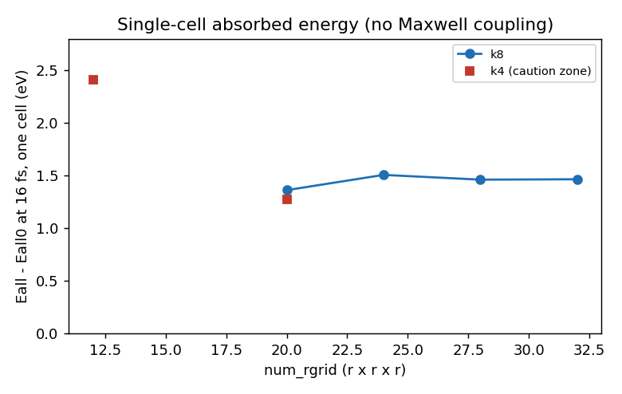
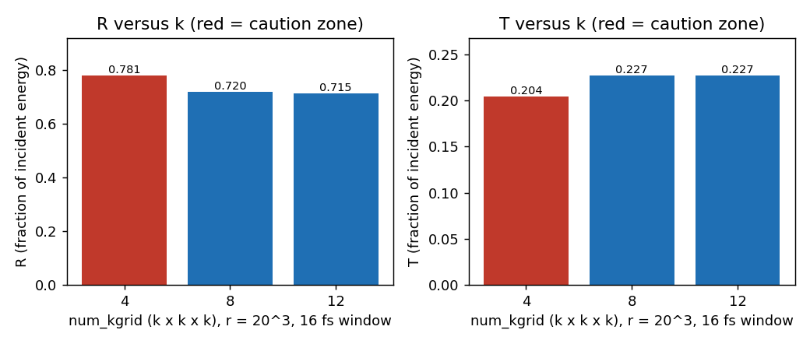
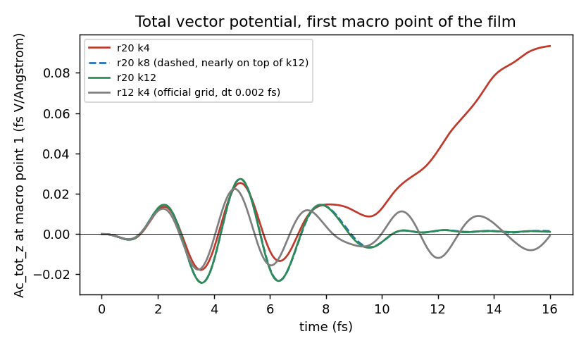
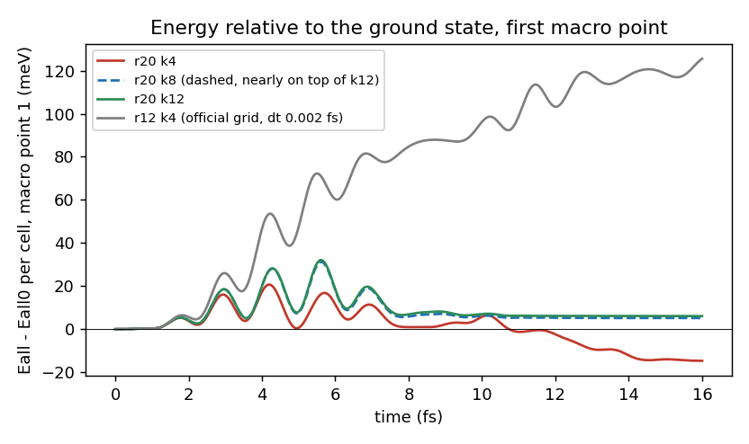
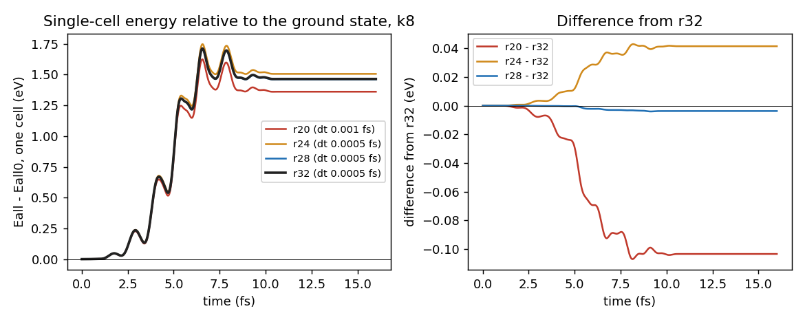
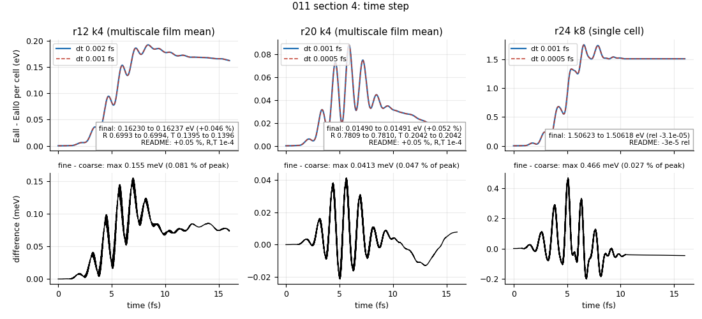
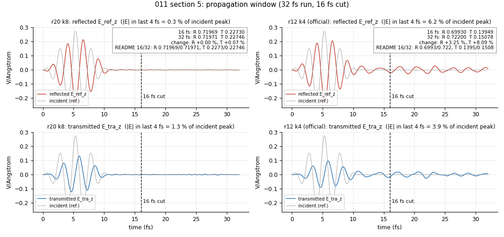
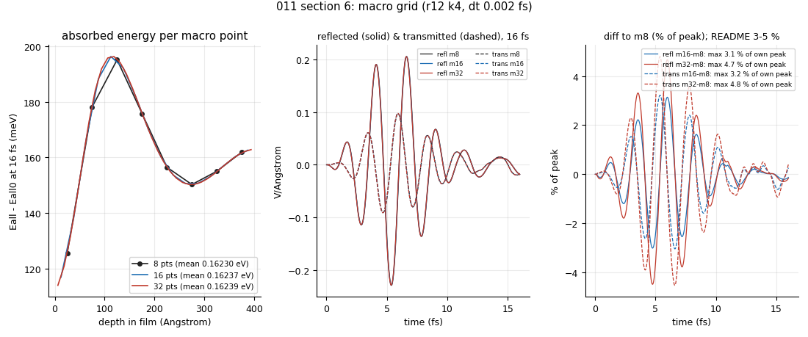

# Learning objective

Set up a Maxwell-TDDFT multiscale calculation (`theory = 'multi_scale_maxwell_tddft'`)
of a thin film starting from the official sample `exercise_07_bulkSi_ms`, and learn
which of its numerical parameters change which output. The outputs are the
reflected and transmitted energy fractions (R, T) and the energy absorbed per unit
cell. The parameters are the k mesh and the real-space grid of the microscopic
cell, the time step, the length of the propagation window and the macro grid of the
Maxwell solver. The central lesson: the official sample grid is a functional test,
not a converged setting, and a convergence statement belongs to one observable (R, T,
the absorbed energy, a waveform) at one setting.

> **Draft; every judgment below is the maintainer's (2026-10-22).** The Judgment
> record holds ten rows and the maintainer judged all of them. Confirmed as proposed
> by the AI assistant: R and T converge at k8 (r20); the official sample grid (r12 k4)
> is a functional test, not converged; the propagation window of 16 fs at r20 k8;
> the origin of the r20 k4 anomaly (not `dt`, not the microscopic cell alone, gone at k8,
> mechanism still a hypothesis); `nstate` = 32 as the setting used. Judged by the
> maintainer in their own words: the k zones (safe zone k >= 8, caution zone k = 4 to
> 6); the real-space grid zones (r20 acceptable when cost requires, r24 preferred, r28
> fully safe); the absorbed energy converged at k8 (read from the time trace, with the
> +10% difference of the final value between k8 and k12 kept as a stated number); the
> time steps (`dt` 0.002 fs at r12, 0.001 fs at r20 and r24, 0.0005 fs at r28 and r32);
> the macro grid of 8 points of 50 Angstrom, limited to integrated quantities
> (absorbed energy and its depth profile, R, T), with the waveform shape not established. Everything that was not varied was an assumption of the assistant and is
> listed in [Assumptions](#assumptions-made-by-the-assistant).

# Summary

One film, one pulse, one pseudopotential: a 400 Angstrom Si film (8 macro points of
50 Angstrom, 1000 vacuum cells on each side, absorbing boundaries), an `Acos2` pulse
of 1.55 eV, 1e12 W/cm^2, `tw1` = 10.672 fs, polarized along z, FHI98PP LDA Si, SALMON
v2.3.0. The official sample uses r = 12^3, k = 4^3, `dt` = 0.002 fs; the base point
here is r = 20^3, k = 8^3, `dt` = 0.001 fs, `nstate` = 32 (ground state with empty
bands, see [SALMON-TS-007](../../troubleshooting/SALMON-TS-007-gs-with-only-occupied-states-converges-slowly.md)).

- **k mesh** (r20, `dt` 0.001 fs, 16 fs). R / T: k4 0.781 / 0.204, k8 0.720 / 0.227,
  k12 0.715 / 0.227. **Maintainer judgment: safe zone k >= 8** (R and T within 1% of
  k12: R changes by 0.7%, T by 0.2%); **caution zone k = 4 to 6** (R and T off by
  several percent, and a spurious static field can appear, see [SALMON-TS-009](../../troubleshooting/SALMON-TS-009-multiscale-coarse-k-spurious-static-field.md)).
- **Absorbed energy: converged at k8 (maintainer judgment, read from the time trace).**
  In the plot of Eall - Eall0 against time at the first macro point the k8 and k12
  curves nearly coincide. The final value still differs: per cell, Eall - Eall0 at
  16 fs grows by +9% to +18% from k8 to k12 at every macro point (film mean 0.0538 to
  0.0594 eV, +10.4%; at macro point 1, 5.1 to 6.1 meV). The maintainer judged this
  small against the transient peak of about 30 meV. The +10% relative difference stays
  as a stated number, and no k16 run exists.
- **Real-space grid** (single cell, k8, absorbed energy at 16 fs): r20 1.361, r24 1.506,
  r28 1.461, r32 1.465 eV. The sequence is not monotone; r28 and r32 agree to 0.26%.
  **Maintainer judgment: r20 acceptable when cost requires it, r24 preferred, r28
  fully safe.**
  The official grid r12 at k4 gives 2.41 eV, 1.9 times the r20 k4 value (1.276 eV):
  **the official grid is a functional test, not converged.**
- **Time step.** `dt` 0.002 to 0.001 fs at r12, and 0.001 to 0.0005 fs at r20 (k4),
  change the film-mean absorbed energy by 0.05% and R, T by 1e-4. **Maintainer judgment:
  take the looser member of each pair: 0.002 fs at r12, 0.001 fs at r20 and r24; r28 and
  r32 use 0.0005 fs because 0.001 fs exceeds the estimated stability limit there.** The
  time resolution a calculation needs depends on the laser intensity (stronger fields
  drive faster dynamics), so these values hold for the pulse used here.
- **Window (maintainer judgment: 16 fs at r20 k8).** At r20 k8, 16 fs and 32 fs windows
  give R and T that differ by at most 1.6e-4 (the reflected and transmitted waves are at
  0.3% of the incident peak at 32 fs): 16 fs is enough there. It is **not** enough at the
  official grid
  (r12 k4: R 0.699 to 0.722, T 0.140 to 0.151 between 16 and 32 fs).
- **Macro grid** (r12 k4, `dt` 0.002 fs): 8, 16, 32 macro points give a film-mean
  absorbed energy of 0.16230, 0.16237, 0.16239 eV and R / T within 0.1% / 0.6% from 8 to 16 points (0.2% / 0.8% from 8 to 32 points, derived).
  **Maintainer judgment: 8 points of 50 Angstrom are enough for the integrated
  quantities (absorbed energy and its depth profile, R, T); the waveform shape is not
  established** (the reflected and transmitted waveforms differ by 3 to 5% of their
  peaks and this does not decrease with more points).
- **The r20 k4 anomaly.** At r20 k4 the total vector potential grows as a ramp after
  the pulse, a static field of about -0.015 V/Angstrom stays in the film, and the
  energy of the first macro points falls below the ground-state energy
  (-14.7 meV per cell). It does not depend on `dt`, it is absent in the single-cell
  calculation, and it is gone at k8; the mechanism stays a hypothesis (maintainer
  judgment). See [SALMON-TS-009](../../troubleshooting/SALMON-TS-009-multiscale-coarse-k-spurious-static-field.md).

These are observations for one model: one film, one pulse, one pseudopotential, SALMON
v2.3.0.

## Context and objective

Tutorial [005](../005-si-gs-convergence-bands-dos/) converged the Si ground state;
a separate linear-response tutorial (in review) converged `Im eps`. A Maxwell-TDDFT run
adds a new layer: every macro point of the film holds its own TDDFT cell, and the
cells see the field of the Maxwell solver, which they in turn change. The observables
are different from the earlier tutorials: the energy fractions R and T are read from the
waves outside the film, and the energy absorbed in each cell from `*_rt_energy.data`.

**Judgment rule used in this tutorial.** Convergence is judged from the numbers
printed in the tables and from the overlays of the time series, one parameter at a
time with every other parameter identical. No script decides convergence. For each
judgment the reasons and the rejected alternatives are written in the
[Judgment record](#judgment-record). The definitions are:

- R = integral of E_ref_z^2 dt divided by the integral of E_inc_z^2 dt over the window
  (columns 7 and 4 of `*_wave.data`); T likewise with E_tra_z (column 10);
- absorbed energy = Eall - Eall0 at the last step (column 3 of `*_rt_energy.data`),
  per unit cell; "film mean" is the mean over the macro points inside the film;
- the zones for k (safe, caution) are the maintainer's wording; the percentages next
  to them are the numbers behind that wording, not thresholds that were fixed in
  advance.

## Conditions

- SALMON: v2.3.0, tag `v.2.3.0`, commit
  `30ba64694ec761cdb6288f01a75b8bcabf05721f`, unmodified for every run.
- Platform: Fugaku (A64FX), Fujitsu compiler, `-Kfast`, SSL2. Four MPI processes
  per node, 12 OpenMP threads per process. For the multiscale runs `nproc_k` is the
  number of processes of **one** macro-point group; SALMON splits the world into
  `nx_m` groups (8 groups x 64 processes on 128 nodes for r20 k8).
- Structure: bulk Si, 8-atom cubic cell, a = 5.43 Angstrom, diamond positions
  (reduced coordinates in the deck). Pseudopotential: ABINIT FHI98PP LDA
  `14-Si.LDA.fhi`, `lloc_ps = 2`, `xc = 'PZ'`; checksum in
  [provenance/run.yaml](provenance/run.yaml).
- Ground state: `theory = 'dft'`, shifted Monkhorst-Pack mesh (no symmetry reduction),
  `nstate` = 32, `nscf` = 300, `threshold` = 1d-9. **Every multiscale run restarts from
  its own ground state** (same r, k, `nstate`). SALMON does not check that the
  restart data matches the deck.
- Multiscale: `nx_m` = 8, `hx_m` = 50 Angstrom (film 400 Angstrom), `nxvacl_m` =
  `nxvacr_m` = 1000 (5 um of vacuum on each side), `boundary_em = 'abc'`. When the
  macro grid was refined (16 and 32 macro points) the vacuum cell counts were scaled so
  that the vacuum stayed 5 um on each side, so that a macro-grid rung changes only the
  macro grid. The run starts from the ground state (`yn_restart = 'n'`, restart
  directory given by `directory_read_data`).
- Pulse: `ae_shape1 = 'Acos2'`, `omega1` = 1.55 eV, `I_wcm2_1` = 1.0d12, `tw1` =
  10.672 fs, `epdir_re1` = (0, 0, 1). Window `nt` * `dt` = 16 fs unless stated.
- Single-cell runs: `theory = 'tddft_pulse'` (same cell, same pulse, no Maxwell
  coupling), used to separate the microscopic cell from the Maxwell coupling.
- Base point: r = 20^3, k = 8^3, `nstate` = 32, `dt` = 0.001 fs, 8 macro points.

## Procedure

1. **Run the ground state for each (r, k)** with empty bands (`nstate` = 32). A
   deck with `nstate` = 16 stalls ([SALMON-TS-007](../../troubleshooting/SALMON-TS-007-gs-with-only-occupied-states-converges-slowly.md)).
2. **Run the official-sample setting first as a functional test** (r12, k4,
   `dt` 0.002 fs, 8 macro points) and read R, T and the absorbed energy per macro point.
3. **Vary one parameter at a time**, all other parameters identical (decks were
   compared pairwise before each submission):
   - k at r20: 4, 8, 12 (`dt` 0.001 fs);
   - r at k8, single cell: 20, 24, 28, 32 (`dt` 0.001 fs for r20, 0.0005 fs for the others);
   - `dt`: r12 k4 0.002 to 0.001; r20 k4 0.001 to 0.0005 (multiscale); r24 k8 single
     cell 0.001 to 0.0005;
   - window: 16 fs against 32 fs at r20 k8 and r12 k4;
   - macro grid: 8, 16, 32 macro points at r12 k4.
4. **Read R and T, the absorbed energy per macro point and the time series of the first
   macro point** (`Ac_tot_z`, `Eall - Eall0`). A calculation can finish normally and
   still be wrong: the r20 k4 run conserved the electron number and had no NaN.
5. [scripts/make_figures.py](scripts/make_figures.py) draws the figures and prints the
   numbers (`make_figures.py <data dir> <figure dir>`; the data directory holds one
   sub-directory per run).

The representative inputs are
[inputs/si-ms-gs-adopted.inp](inputs/si-ms-gs-adopted.inp) (ground state) and
[inputs/si-ms-maxwell-tddft-adopted.inp](inputs/si-ms-maxwell-tddft-adopted.inp)
(multiscale), both at the base point (r20, k8). They differ from the executed decks in
`sysname`, the pseudopotential path, the restart directory and comments. The executed
multiscale decks read the ground-state restart in place through an absolute
`directory_read_data`; in the tutorial it is `./restart/`, a copy of the `data_for_restart/`
directory of the ground state, as in the official exercise. **These decks are a base
point, not a converged production setting.**

## Observed result

All runs shown finished with the requested number of steps and conserved the electron
number; the single-cell and multiscale decks were checked for NaN. Time series are
those of the first macro point (the one facing the incident pulse) unless stated.

Differences labeled "derived" are computed in this tutorial from the printed values; the
absolute values stay next to them. Absorbed energies are Eall - Eall0 per unit cell in
eV (the cell has 8 atoms). R and T are dimensionless energy fractions, so their
differences are absolute. The time-trace differences of the `dt` ladder are in % of the
peak of the trace. The ground-state energy differences are also given in meV/atom
(the eV value times 1000, divided by 8). Energy differences of the absorbed-energy
ladders are also given in meV/atom, labeled derived (for example 0.145 eV per cell =
18.125 meV/atom).

### Convergence by observable

Every cell with a verdict quotes the maintainer ([Judgment record](#judgment-record) row in
brackets). The other cells give the measured change and say "not judged". The ladders are
one-variable studies at different base points: k and window at r20 k8 (window) or r20 (k);
r at k8, single cell; `dt` at r12 k4, r20 k4 and r24 k8; macro grid at r12 k4.

| observable | k mesh (r20, 16 fs) | real-space grid (single cell, k8) | time step | window | macro grid (r12 k4) |
|---|---|---|---|---|---|
| R | k8 (-0.005, 0.7 % from k8 to k12; maintainer, rows 1 and 2) | not examined in the multiscale run; r12 k4 against r20 k4 gives R + T 0.839 against 0.985 (functional test, row 5) | change 1e-4 at r12 k4 and r20 k4; looser member taken; maintainer, row 6 | 16 fs at r20 k8 (2e-5; maintainer, row 7); 3 % at r12 k4 | 8 points (0.0009, 0.13 % from 8 to 16 points, derived; maintainer, row 8) |
| T | k8 (-0.0004, 0.2 % from k8 to k12; maintainer, rows 1 and 2) | not examined (as R) | change 1e-4 at r12 k4 and r20 k4 (maintainer, row 6) | 16 fs at r20 k8 (1.6e-4; maintainer, row 7); 8 % at r12 k4 | 8 points (0.0009, 0.65 % from 8 to 16 points, derived; maintainer, row 8) |
| absorbed energy, final value (film mean in the multiscale runs) | k8 (+0.0056 eV, +10.4 % from k8 to k12; maintainer, row 3, read from the time trace) | single cell: r24 preferred, r20 acceptable when cost requires it, r28 fully safe (maintainer, row 4); r28 to r32 +0.26 % | +0.05 % at r12 k4 and r20 k4, -3e-5 relative at r24 k8 (single cell); looser member taken (maintainer, row 6) | not examined | 8 points for the integrated quantities (0.04 % from 8 to 16 points; maintainer, row 8) |
| waveform (reflected, transmitted) | not examined | not examined | not examined | at r20 k8 negligible after 16 fs; 3 to 6 % of the incident peak at 32 fs at r12 k4 (not judged) | shape not established (3.1 to 3.2 % of its own peak at 16 points, 4.7 to 4.8 % at 32 points, against 8 points; maintainer, row 8) |

R and T converge early in k (k8 against k12 within 1 %). The final value of the absorbed
energy keeps moving by 10 % between k8 and k12 and was taken as converged at k8 only from
the time trace (the maintainer). In the real-space grid the absorbed energy is not
monotone and still moves by 3 % from r24 to r28. The waveform shape is not established
(its difference does not decrease with more macro points). R, T and the absorbed energy do not depend on `dt` at this level.

### Ladder: k mesh (r20, `dt` 0.001 fs, 16 fs)

| pair | R | T | R + T | film-mean absorbed energy (eV) | macro point 1 (eV) | earlier rung against k12 (densest, derived): R | T | R + T | film-mean absorbed energy (eV) | macro point 1 (eV) |
|---|---|---|---|---|---|---|---|---|---|---|
| k4 to k8 | 0.781 to 0.720 (-0.061, -7.8 %) | 0.204 to 0.227 (+0.023, +11.3 %) | 0.985 to 0.947 (-0.038) | 0.0149 to 0.0538 (+0.0389; derived +4.8625 meV/atom) | -0.0147 to 0.0051 (+0.0198; derived +2.475 meV/atom) | 0.781 to 0.715 (-0.066, -8.5 %) | 0.204 to 0.227 (+0.023, +11.3 %) | 0.985 to 0.942 (-0.043) | 0.0149 to 0.0594 (+0.0445; derived +5.5625 meV/atom) | -0.0147 to 0.0061 (+0.0208; derived +2.6 meV/atom) |
| k8 to k12 | 0.720 to 0.715 (-0.005, -0.7 %) | 0.227 to 0.227 (-0.0004, -0.2 %) | 0.947 to 0.942 (-0.005) | 0.0538 to 0.0594 (+0.0056, +10.4 %; derived +0.7 meV/atom) | 0.0051 to 0.0061 (+0.0010, +18 % as reported; derived +19.6 %, 0.0010 / 0.0051; +0.125 meV/atom) | same as the pair | same as the pair | same as the pair | same as the pair | same as the pair |

The differences of R + T, the percentages (except +18 %, which was reported; the
recomputation +19.6 % is next to it), the meV/atom values, the k4 to k8 rows of the absorbed energy and
the last five columns (the earlier rung against the densest rung k12) are derived. The absolute values per
macro point behind the film mean are in the [Validation](#supporting-tables) section.

The cost of safety is real (k12 took about three times as long as k8 on the same 128
nodes), which is why the zones are given as a trade-off and not as a single value.
The k5 and k6 meshes were not run, and there is no k16 run.

The maintainer read the time trace of Eall - Eall0 at the first macro point (the figure in
[the r20 k4 anomaly](#the-r20-k4-anomaly-summary-mechanism-in-salmon-ts-009)): the k8 and
k12 curves nearly coincide, and the final values differ by about 1 meV per cell at macro
point 1 (5.1 and 6.1 meV, +18 %), against a transient peak of about 30 meV. The film mean
differs by +10.4 % (0.0538 and 0.0594 eV). The maintainer judged this small and took k8
as converged for the absorbed energy; the +10 % relative difference of the final value is
kept here as a number, not hidden. The same 10 % appears in the absorbed fraction: R + T at
32 fs, r20 k8, is 0.9472 (tails negligible), so about 5.3 % of the incident energy is
absorbed, and at k12 the 16 fs value gives 5.85 %, assuming the tails are similarly
negligible. The absorption is a small remainder of two large numbers, so a given relative
change in R and T moves it more. There is no k16 run, so the size of any remaining change
is unknown.

**Judgment (the maintainer; [Judgment record](#judgment-record) rows 1 to 3):** the change
of R and T became small at k8 to k12 (0.7 % and 0.2 %) and k8 was taken, as the start of a
safe zone, **safe zone k >= 8** (R and T within 1 % of the k12 value), **caution zone
k = 4 to 6** (R and T off by several percent, and the run may carry a spurious static
field, see [the anomaly below](#the-r20-k4-anomaly-summary-mechanism-in-salmon-ts-009)).
k = 5 and 6 were not run here; the zone edge at 6 is the maintainer's wording, the runs are
k4, k8, k12. The absorbed energy was judged converged at k8 (row 3).

### The r20 k4 anomaly (summary; mechanism in [SALMON-TS-009](../../troubleshooting/SALMON-TS-009-multiscale-coarse-k-spurious-static-field.md))

This is a diagnostic of the k ladder, not a ladder of its own; its two figures are the time
series that the k judgments above refer to.

At r20 k4 the total vector potential at the first macro point rises as a ramp after the
pulse and reaches 0.0933 fs V/Angstrom at 16 fs, still rising, at every macro point with
the same value; the mean total field over 10 to 15 fs is -0.0151 V/Angstrom. At the
same time the energy of the first three macro points falls below the ground-state energy
(Eall - Eall0 = -0.0147 eV per cell at 16 fs, negative for about a third of the run). At
r20 k8 and k12 the vector potential returns to about zero after the pulse (0.0015 and
0.0011 at 16 fs) and the energy is not negative. The r12 k4 run of the official grid
does not show it either (the gray curve oscillates around zero). The run passes the
usual checks (electron number conserved, no NaN): **a clean finish does not show it**.

The diagnosis chain, summarized:

1. **Not the time step.** `dt` 0.001 and 0.0005 fs give the same ramp (0.0933), the same
   field (-0.0151 V/Angstrom), the same energy at the first macro point (-0.0147 eV) and the
   same R and T (0.781, 0.204) to 1e-4. Explanations that depend on `dt` (non-unitarity of
   the Taylor propagator, an O(dt) inconsistency between the current and the vector
   potential, a one-step delay of the Maxwell solver) are therefore not the cause.
2. **Not the microscopic cell alone.** The single-cell run at r20 k4 has no negative
   energy (+1.276 eV at 16 fs) and no ramp.
3. **Gone at k8** (and k12), at the same r, grid and `dt`.
4. The remaining candidate is the sum over the Brillouin zone at k4: the uniform
   component of the vector potential that the Maxwell solver keeps acts as a constant
   field on a coarse mesh instead of a gauge. This is a hypothesis; the tutorial does not claim
   it is proven. [SALMON-TS-009](../../troubleshooting/SALMON-TS-009-multiscale-coarse-k-spurious-static-field.md) holds the diagnosis and the check list.

Practical rule: at k4 to k6 look at the time series of `Ac_tot_z` and of
`Eall - Eall0` after the pulse before trusting R, T or the absorbed energy.

### Ladder: real-space grid (single cell, k8)

Single-cell pulse (`tddft_pulse`, no Maxwell coupling), k8 unless stated, absorbed energy
at 16 fs. `dt` is 0.001 fs for r20 and r24 and 0.0005 fs for r28 and r32 (r24 gives 1.506
eV at both).

| pair | Eall - Eall0 at 16 fs (eV) | ground-state energy at t = 0 (eV) | to the densest rung r32 (Eall - Eall0) |
|---|---|---|---|
| r20 to r24 | 1.361 to 1.506 (+0.145, +10.7 %; derived +18.125 meV/atom) | -864.43 to -864.63 (-0.20, -25 meV/atom) | r20: -0.104 eV, -7.1 % (derived -13 meV/atom) |
| r24 to r28 | 1.506 to 1.461 (-0.045, -3.0 %; derived -5.625 meV/atom) | -864.63 to -864.50 (+0.13, +16 meV/atom) | r24: +0.041 eV, +2.8 % (derived +5.125 meV/atom) |
| r28 to r32 | 1.461 to 1.465 (+0.004, +0.26 %; derived +0.5 meV/atom) | -864.50 to -864.73 (-0.23, -29 meV/atom) | r28: -0.004 eV, -0.3 % (derived -0.5 meV/atom) |
| r12 to r20 (k4, official grid; single cell, r12 at `dt` 0.001 fs, the official multiscale setting uses 0.002 fs) | 2.411 to 1.276 (-1.135 eV, derived -141.875 meV/atom; -47 %, derived: (1.276 - 2.411) / 2.411 = -47.1 %) | not given | not applicable |

The eV differences, the +10.7 %, the -47 %, the meV/atom values of the absorbed energy and the ground-state differences in meV/atom (divided by 8
atoms, from the rounded energies) are derived; the percentages to r32 and -3.0 % and +0.26 %
are the printed values. The sequence r20, r24, r28, r32 is **not monotone**: r24 sits 3 %
above r28 and r32, so only "r28 and r32 agree to 0.26 %" is shown, not a converging
sequence. The ground-state total energy at t = 0 is also not monotone in r, so the
irregularity is already in the ground state and not introduced by the dynamics.

The current along the field is nearly the same on all four grids (peak 0.06557 at r20
against 0.06665 at r32, -1.6 %); the difference shows in the absorbed energy, which
accumulates it over the pulse. r36 was not run.

The official grid, r12 at k4, gives 2.41 eV, 1.9 times the r20 k4 value (same k, 1.276
eV). R + T at r12 k4 is 0.839 at 16 fs against 0.985 at r20 k4. **The official sample grid
(r12, k4) is a functional test, not a converged setting** (the maintainer, row 5). The r
and k ladders here were run at the base values of the other (r at k8, k at r20); they were
assumed independent and the intersection (for example r28 with k12) was not run.

**Judgment (from the time series of the absorbed energy; the maintainer,
[Judgment record](#judgment-record) row 4): r20 is acceptable when cost requires it, r24
is preferred, and r28 is fully safe.** The maintainer did not name a pair at which the
change became small; r28 to r32 is the smallest one (+0.26 %).

### Ladder: time step

| pair | absorbed energy | R | T | maximum difference of the time trace (% of its peak) |
|---|---|---|---|---|
| r12 k4, `dt` 0.002 to 0.001 fs | film mean 0.16230 to 0.16237 eV (+0.05 % as reported; derived +0.0431 %, +0.00875 meV/atom) | 0.6993 to 0.6994 (1e-4) | 0.1395 to 0.1396 (1e-4) | 0.081 |
| r20 k4, `dt` 0.001 to 0.0005 fs | film mean 0.01490 to 0.01491 eV (+0.05 % as reported; derived +0.0671 %, +0.00125 meV/atom) | 0.7809 to 0.7810 (1e-4) | 0.2042 (1e-4) | not printed |
| r24 k8, single cell, `dt` 0.001 to 0.0005 fs | 1.50623 to 1.50618 eV (-3e-5 relative; derived -0.00625 meV/atom) | not applicable | not applicable | 0.027 |

For each pair the two curves nearly coincide (lower panels of the figure); the change of
the final value is the separate quantity in the second column. The +0.05 % labels are the reported
values; recomputed from the printed endpoints the changes are +0.0431 % (r12) and +0.0671 %
(r20), derived (the unrounded outputs behind the label are not recorded here).
There is no densest-rung column: each pair has two members only.

`dt` is not a factor at this level. The r20 test was made at k4 (the anomalous run) and
r24, not at the base point k8, and it was not repeated at r28 and r32. The explicit
time stepping has a stability limit that falls with the grid spacing, about as 1/r^2
(estimate from the finite-difference stencil, as in a separate linear-response tutorial
(in review): about 0.0018 fs at r20, 0.0012 fs at r24 and 0.0009 fs at r28, an estimate
and not a measurement).

**Judgment (the maintainer, [Judgment record](#judgment-record) row 6): take the looser
member of each pair: `dt` = 0.002 fs at r12, and 0.001 fs at r20 and r24; r28 and r32 use
0.0005 fs because 0.001 fs exceeds the estimated stability limit there.** The maintainer's
caveat: the time resolution a calculation needs depends on the laser intensity (stronger
fields drive faster dynamics), so these values hold for the pulse used here (1e12 W/cm^2).

### Ladder: propagation window

| run | R, 16 fs to 32 fs | T, 16 fs to 32 fs |
|---|---|---|
| r20 k8 | 0.71969 to 0.71971 (+2e-5) | 0.22730 to 0.22746 (+1.6e-4) |
| r12 k4 (official grid) | 0.6993 to 0.7220 (+0.0227, +3.2 %) | 0.1395 to 0.1508 (+0.0113, +8.1 %) |

At r20 k8 the waves are negligible after 16 fs, at r12 k4 they are not (the figure). At the
official grid the reflected and transmitted waves are still 3 to 6 % of the incident peak
at 32 fs (so R and T at 32 fs are not final either). The needed window is a property of the
setting: check it for each grid. The absolute and percentage differences at r12 k4 are
derived; the percentages were printed as 3 % and 8 %.

**Judgment (the maintainer, row 7, confirmed as proposed by the AI assistant): 16 fs is
enough at r20 k8** (2e-5 in R and 1.6e-4 in T). It is not enough at the official grid;
coarse grids need a check.

### Ladder: macro grid (r12 k4, `dt` 0.002 fs)

Film of 400 Angstrom.

| pair | spacing | film-mean absorbed energy (eV) | R | T | waveform difference from the 8-point run (% of its own peak) | earlier rung against 32 points (densest, derived): film-mean absorbed energy (eV) | R | T | waveform difference (% of its own peak) |
|---|---|---|---|---|---|---|---|---|---|
| 8 to 16 points | 50 to 25 Angstrom | 0.16230 to 0.16237 (+0.04 %; derived +0.00875 meV/atom) | 0.6993 to 0.6984 (-0.0009, -0.13 %) | 0.1395 to 0.1404 (+0.0009, +0.65 %) | 3.1 to 3.2 | 0.16230 to 0.16239 (+0.06 %; derived +0.01125 meV/atom) | 0.6993 to 0.6981 (-0.0012, -0.17 %) | 0.1395 to 0.1406 (+0.0011, +0.79 %) | 4.7 to 4.8 |
| 16 to 32 points | 25 to 12.5 Angstrom | 0.16237 to 0.16239 (+0.01 %; derived +0.0025 meV/atom) | 0.6984 to 0.6981 (-0.0003, -0.04 %) | 0.1404 to 0.1406 (+0.0002, +0.14 %) | not printed | same as the pair | same as the pair | same as the pair | same as the pair |

The film mean is flat from 16 points on, and the per-point absorbed energies differ by at
most 1.2 % after block-averaging the fine grids onto the 8 points. The reflected and
transmitted **waveforms** differ by 3 to 5 % of their peaks between the macro grids (a
phase shift of the front surface was suspected; not explained) and this does not decrease
with more points, while their time-integrated energies agree within 0.1 % (R) and 0.6 %
(T) between 8 and 16 points (0.2 % and 0.8 % between 8 and 32 points, derived). Recomputed from the printed R and T
(derived): 8 to 16 points R -0.1287 %, T +0.6452 %; 8 to 32 points R -0.1716 %, T +0.7885 %;
these exceed the stated 0.1 % and 0.6 % bounds slightly. The
waveform differences are relative to the 8-point run, not to the densest rung. The
macro-grid test was made at the official setting (r12 k4) and not at the base point. The
absolute differences and percentages in the R and T columns are derived from the printed
values.

**Judgment (the maintainer, [Judgment record](#judgment-record) row 8): 8 macro points of
50 Angstrom are enough for the integrated quantities (absorbed energy and its depth
profile, R, T); the waveform shape is not established.** The film mean was already flat
at 8 to 16 points.

### Recommended settings by use

| use | setting | measure | evidence |
|---|---|---|---|
| structure, pseudopotential, `xc` | Si 8-atom cubic, 5.43 Angstrom; FHI98PP LDA; PZ | not varied | assumed by the AI assistant |
| pulse | `Acos2`, 1.55 eV, 1e12 W/cm^2, `tw1` 10.672 fs, z | not varied | assumed by the AI assistant |
| `num_kgrid`, R and T | k >= 8 safe zone; k4 to k6 caution zone | k8 against k12 within 1 % (R -0.7 %, T -0.2 %); spurious field at k4 | maintainer, rows 1 and 2 |
| `num_kgrid`, absorbed energy | k8 | time trace of Eall - Eall0 at k8 and k12 nearly coincides; final value +10.4 % in the film mean (+10 % relative) | maintainer, row 3 |
| `num_rgrid` | r20 acceptable when cost requires; r24 preferred; r28 fully safe | single-cell absorbed energy against r32 (k8): r20 -7.1 %, r24 +2.8 %, r28 -0.3 % | maintainer, row 4 |
| `dt` | 0.002 fs at r12; 0.001 fs at r20 and r24; 0.0005 fs at r28 and r32 (for this pulse) | changes of 0.05 %; estimated stability limit about 0.0018 fs at r20, 0.0012 at r24, 0.0009 at r28 | maintainer, row 6 |
| window | 16 fs at r20 k8; check at every grid | 16 against 32 fs: 1.6e-4 | maintainer, row 7 |
| macro grid | 8 points of 50 Angstrom, for integrated quantities only | flat from 16 points (r12 k4); waveform shape not established | maintainer, row 8 |
| `nstate` | 32 for the ground state, as in the official sample (16 occupied and 16 empty states); not varied | [SALMON-TS-007](../../troubleshooting/SALMON-TS-007-gs-with-only-occupied-states-converges-slowly.md) | maintainer, row 10 (setting used, not a convergence claim) |

The representative inputs are listed in the Procedure; they are a base point, not a
converged production setting.

## Judgment record

| # | object | conclusion | judged by | what was looked at | reason, including rejected alternatives |
|---|---|---|---|---|---|
| 1 | k zones for R and T | safe zone k >= 8; caution zone k = 4 to 6 | **maintainer** (review comment, 2026-10-06) | R and T at k4, k8, k12 at r20; time series at k4 | The maintainer wrote that k >= 8 is preferable, that smaller k looks much less accurate, and that since it is a cost trade-off a "safe zone / caution zone" wording is acceptable. Numbers behind it: k8 to k12 R -0.7%, T -0.2%; k4 to k8 R -8%, T +11%, and a spurious static field at k4. A single recommended k was rejected because the cost of k12 (about three times k8) matters for the user. |
| 2 | R and T converged at k8 | yes at r20 | **maintainer (2026-10-22)**: confirmed as proposed by the AI assistant | R, T at k4, k8, k12; 16 fs against 32 fs | The assistant took "within 1% of k12" as the working meaning. Not tested: k16, other r (the k ladder is at r20 only). |
| 3 | absorbed energy | converged at k8 (maintainer's reading of the time trace); the final value still differs by +10% relative between k8 and k12 | **maintainer (2026-10-22)**: converged at k8, overriding the AI assistant's "not converged at k12" | time trace of Eall - Eall0 at the first macro point (figure in [the anomaly subsection](#the-r20-k4-anomaly-summary-mechanism-in-salmon-ts-009)), k8 against k12; per-point final values | The k8 and k12 curves nearly coincide; the final value differs by about 1 meV per cell at macro point 1 (+18%) and +10.4% in the film mean, small against the transient peak of about 30 meV. The assistant had called it not converged because the final value moves by 10% and equals the change of 1 - R - T (5.3% to 5.85%); the maintainer weighed the whole trace instead. No k16 run, so it is not known where it settles. |
| 4 | real-space grid | r20 acceptable when cost requires; r24 preferred; r28 fully safe | **maintainer** (2026-10-21) | time series of Eall - Eall0 and of the current for r20, r24, r28, r32 at k8 (single cell), each with its difference from r32 | The maintainer judged from the time series of the absorbed energy; the currents look the same for all four grids (peak within 1.6%). Numbers behind it: absorbed energy at 16 fs against r32: r20 -7.1%, r24 +2.8%, r28 -0.3%. The sequence is not monotone, and r36 was not run. For comparison, the absorbed energy changes by about 10% from k8 to k12 (row 3). |
| 5 | official sample grid (r12, k4) | functional test, not converged | **maintainer (2026-10-22)**: confirmed as proposed by the AI assistant | single-cell energy 2.41 against 1.28 eV (r12 against r20, k4); R + T 0.839 against 0.985; window sensitivity | The size of the differences (a factor of 1.9 in the absorbed energy, 3 to 8% in R and T with the window) is far from the other rungs' changes. |
| 6 | time step | the looser member of each pair: r12 0.002 fs; r20 and r24 0.001 fs; r28 and r32 0.0005 fs, because 0.001 fs exceeds the estimated stability limit there (about 0.0018 fs at r20, 0.0012 at r24, 0.0009 at r28, falling about as 1/r^2) | **maintainer (2026-10-22)**: the looser member of each pair, with the stability limit setting r28 and r32 | `dt` pairs in [Ladder: time step](#ladder-time-step) (figure [dt-pairs.png](figures/dt-pairs.png)) | Changes of 0.05% in absorbed energy and 1e-4 in R and T. Tested at r12 k4, r20 k4 and r24 k8 (single cell) and not at the base point. Caveat from the maintainer: the time resolution a calculation needs depends on the laser intensity (stronger fields drive faster dynamics), so these values hold for the pulse used here. |
| 7 | window | 16 fs at r20 k8 | **maintainer (2026-10-22)**: confirmed as proposed by the AI assistant | R, T at 16 and 32 fs | 1.6e-4 at r20 k8, but 3% and 8% at r12 k4. A fixed 16 fs was rejected as a general rule; coarse grids need a check (r12 k4 changes R and T by 3 and 8%). See figure [propagation-window.png](figures/propagation-window.png). |
| 8 | macro grid | 8 points of 50 Angstrom, limited to integrated quantities (absorbed energy and its depth profile, R, T); the waveform shape is not established | **maintainer (2026-10-22)**: confirmed for integrated quantities, with the waveform limit added | film mean and R, T for 8, 16, 32 points at r12 k4; waveform differences (figure [macro-grid.png](figures/macro-grid.png)) | Flat from 16 points. The reflected and transmitted waveforms differ from the 8-point run by 3.1 to 3.2% (16 points) and 4.7 to 4.8% (32 points) of their own peak, and this does not decrease with more points; it was not explained and the test was at the official setting. |
| 9 | origin of the r20 k4 anomaly | not `dt`, not the microscopic cell alone, gone at k8; mechanism left as a hypothesis | **maintainer (2026-10-22)**: confirmed as proposed by the AI assistant | `dt` pair, single-cell run, k ladder | Alternatives that depend on `dt` were rejected by the `dt` pair; the Brillouin-zone sum hypothesis is not proven. See [SALMON-TS-009](../../troubleshooting/SALMON-TS-009-multiscale-coarse-k-spurious-static-field.md). |
| 10 | `nstate` | 32, the same as the official sample (Si, 8-atom cubic cell, 32 electrons, so 16 occupied and 16 empty states); not varied | **maintainer (2026-10-22)**: as the setting used, not a convergence claim | ground-state deck; [SALMON-TS-007](../../troubleshooting/SALMON-TS-007-gs-with-only-occupied-states-converges-slowly.md) | A deck with only the occupied states stalls; `nstate` was not scanned. |

## Assumptions made by the assistant

Fixed by the drafting assistant, not varied, and not convergence results.

- Bulk Si at the experimental lattice constant (5.43 Angstrom); FHI98PP LDA, `xc = 'PZ'`;
  no spin-orbit coupling; shifted Monkhorst-Pack mesh without symmetry reduction, with the
  same mesh in the real-time and ground-state runs.
- The film (8 macro points x 50 Angstrom) and the vacuum (1000 cells = 5 um on each side
  at 50 Angstrom spacing), `abc` boundaries and the pulse come from the official sample;
  the pulse peak intensity, frequency and duration were not varied; z polarization only.
- The comparison quantities are the assistant's choice: R and T as time-integrated energy
  ratios over the whole window, and the absorbed energy as Eall - Eall0 at the last step.
  The R and T values were not checked against a transfer-matrix reference.
- The 16 fs window was taken from the official sample and the 32 fs window as the test.
- The k, r, `dt`, window and macro-grid studies were taken as independent one-variable
  studies at different base points (k and window at r20; r at k8, single cell; macro grid
  at r12 k4), not at one common point.
- The single-cell absorbed energy was used as the probe of the microscopic cell; it is not
  the absorbed energy of the film.
- The ground-state convergence settings (`threshold = 1d-9`, `nscf = 300`) were taken from
  the official sample.

## Validation

- Every run was checked for the requested number of steps, for electron-number
  conservation and for non-finite values in the output files before it was used.
- Controlled comparisons: decks were compared pairwise before submission and differ only in
  the ladder variable (and, for the macro grid, the vacuum cell count that keeps 5 um).
- Every multiscale or single-cell run used the ground state with the same r, k and
  `nstate`; the restart data is not validated by SALMON, so each run directory was checked
  against its plan.
- The tables are produced by the script in this directory from the output files; the
  single-cell energies, R and T agree with the values read during collection.
- **Not validated:** k5, k6 and k16 were not run. The `dt`, window and macro-grid studies
  were not made at the base point. The r ladder is single cell only; no multiscale run
  exists at r28 or r32. The absorbed energy is judged converged at k8 from the time trace
  while its final value still differs by +10% relative from k12, and no k16 run exists.
  The waveform shape on the macro grid is not established. The r36 check was not run. The
  mechanism of the r20 k4 anomaly is a hypothesis. Other pulses (intensity, frequency,
  polarization), film thickness, vacuum size and boundary condition were not examined;
  the time steps hold for this pulse only.

### Supporting tables

Absolute values per macro point behind the film mean of the k ladder (absorbed energy per unit cell at 16 fs, eV; r20, `dt` 0.001 fs):

| macro point (front to back) | 1 | 2 | 3 | 4 | 5 | 6 | 7 | 8 | film mean |
|---|---:|---:|---:|---:|---:|---:|---:|---:|---:|
| k4 | -0.0147 | -0.0133 | -0.0087 | 0.0011 | 0.0159 | 0.0331 | 0.0484 | 0.0574 | 0.0149 |
| k8 | 0.0051 | 0.0105 | 0.0215 | 0.0385 | 0.0600 | 0.0823 | 0.1009 | 0.1115 | 0.0538 |
| k12 | 0.0061 | 0.0124 | 0.0246 | 0.0432 | 0.0664 | 0.0904 | 0.1103 | 0.1216 | 0.0594 |
| k8 to k12 | +18% | +18% | +15% | +12% | +11% | +10% | +9% | +9% | +10% |

## Surprises and failures recorded

- **A calculation that finishes cleanly can be wrong.** The r20 k4 run ended normally, kept
  the electron number and had no NaN, and still carried a static field and negative
  energies. Only the time series after the pulse show it.
- **The official sample setting (r12 k4) looked reasonable and is far from converged.**
  Its absorbed energy is 1.9 times larger than at r20 (same k), and its window is too short.
- **The final value of the absorbed energy moves more than R and T.** R and T are within
  1% at k8 and k12 while the final absorbed energy moves by 10% (the absorption is a small
  remainder of two large numbers); the maintainer still judged the absorbed energy converged
  at k8 from the time trace, where the k8 and k12 curves nearly coincide.
- **The r dependence of the absorbed energy is not monotone** (r24 above r28 and r32), and
  the ground-state energy has the same irregularity.

## Lessons learned

- **Start from the official sample as a functional test and do not treat its grid as
  converged.** Check R, T and the absorbed energy at a denser r and k before using the
  numbers.
- **Look at the time series after the pulse** (`Ac_tot_z`, `Eall - Eall0`) at every
  macro point, especially at small k: a ramp or a negative energy means the run is not valid
  even if it finished.
- **Give k as zones when the cost matters:** safe zone k >= 8 for R and T, caution zone
  k = 4 to 6. Say which observable the zone is for.
- **Judge the absorbed energy on its own, from its time trace and per macro point,** and do
  not infer it from R and T: its final value differed by +10% between k8 and k12 while R and
  T differed by under 1%; the maintainer took this as converged at k8.
- **Check the window for each grid:** it was enough at r20 k8 and not at r12 k4.
- **The time step and the macro grid were not the limiting parameters** here; the
  microscopic k mesh and grid were. The time step needed depends on the laser intensity and
  on the grid (stability limit falling about as 1/r^2).
- **Keep k-points per node low** at large r ([SALMON-TS-010](../../troubleshooting/SALMON-TS-010-fugaku-gs-killed-too-many-k-points-per-node.md)), and run a ground state with
  `nstate` above the number of occupied bands ([SALMON-TS-007](../../troubleshooting/SALMON-TS-007-gs-with-only-occupied-states-converges-slowly.md)).

## Limitations and applicability

This tutorial covers one 400 Angstrom Si film, one pulse (1.55 eV, 1e12 W/cm^2, z), PZ-LDA,
FHI98PP, no spin-orbit coupling, SALMON v2.3.0 on Fugaku (A64FX).

- The k zones are for R and T at r20; they say nothing about other thicknesses or other
  pulses. The absorbed energy is judged converged at k8 by the maintainer's reading of the
  time trace, with a +10% relative difference of the final value from k12.
- The real-space grid zones come from the single-cell absorbed energy at k8; no
  multiscale run exists at r24 to r32.
- The time steps hold for the pulse used here; stronger fields need finer resolution.
- The macro grid conclusion holds for integrated quantities only; the reflected and
  transmitted waveform shape is not established.
- Every judgment in the Judgment record is the maintainer's (2026-10-22); the status stays
  draft until a reviewer sets it.

## References

- SALMON official samples `exercise_04_bulkSi_gs` and `exercise_07_bulkSi_ms` in the SALMON
  v2.3.0 source tree (tag `v.2.3.0`), as the base of the decks.
- [ABINIT LDA FHI pseudopotential collection](https://www.abinit.org/atomic_data/psps/miscellaneous/ATOMICDATA/LDA_FHI/)
- Related tutorial: [005 Si ground-state convergence](../005-si-gs-convergence-bands-dos/)
- A separate linear-response tutorial for the same Si cell (in review) converged `Im eps`.
- Troubleshooting: [TS-007](../../troubleshooting/SALMON-TS-007-gs-with-only-occupied-states-converges-slowly.md),
  [TS-009](../../troubleshooting/SALMON-TS-009-multiscale-coarse-k-spurious-static-field.md),
  [TS-010](../../troubleshooting/SALMON-TS-010-fugaku-gs-killed-too-many-k-points-per-node.md)
- Run provenance: [provenance/run.yaml](provenance/run.yaml). Raw outputs are not committed.
