# Learning objective

Run a real-time linear response (`theory = 'tddft_response'`, impulse) and a
real-time pulse (`theory = 'tddft_pulse'`) for a hard, light-element crystal and
choose the time step, the real-space grid and the k mesh for the observable that
will be used. Learn how the explicit time-step limit follows the grid and drives
the cost; why an undamped spectrum on a coarse k mesh cannot be compared point by
point, and how a damped rebuild of the spectrum with a shift-and-shape comparison
makes the grid and k ladders readable; that for this response the k mesh, not the
grid, sets the accuracy of the absorption shape, and that a constant baseline of the
post-kick current, larger on a coarse grid, lowers `Re eps_z` below the gap and mimics a grid
dependence unless it is subtracted; that the answer to "which r and k" depends on the
use; how the energy and the number of excited electrons left after a pulse scale
with intensity; and what to do when a long linear-response run is killed before
SALMON writes its spectrum.

> **Status.** The grid was tested for the linear
> response (r16 to r32 at k 6^3) and the k mesh up to 24^3 (at r20). The
> maintainer judged on 2026-10-14 that r16 can be enough depending on the use,
> that r20 is already quite sufficient, and that k16 is slightly loose, depending
> on the use, and **adopted r = 20, k = 20^3** (the existing ladder run; no
> separate confirmation run). After that judgment the post-kick current was
> found to settle at a constant baseline (1.8e-4 to 9.9e-4 of the peak of `Jm_z`), which lowers
> `Re eps_z` at 1 eV by 3 to 16 % as is; with it subtracted, `Re eps_z` at 1 eV is within
> about 0.1 % of r32 from r16 to r32 and of k24 from k10 to k20 ([section 4](#4-low-frequency-artifact-and-yn_lr_w0_correction)).
> The earlier 1 eV reason for the r zones (r20 -3 %, r16 -14 %) is superseded, and
> low-energy `Re eps_z` is read with the baseline subtracted (row 12). On 2026-10-22 the
> maintainer confirmed the time step, the static dielectric constant, the intensity
> scaling (for now), the damping and comparison metric and the zones by use, and chose
> r20 k6 for the refractive index below the gap and r20 k20 for the absorption shape
> ([Recommended settings by use](#recommended-settings-by-use)). **No row of the
> [Judgment record](#judgment-record) is provisional.** The adopted point is unchanged
> (r = 20, k = 20^3). The pulse runs were done at one k mesh (6^3), one grid (32^3) and
> one time step and were not part of the ladders. Everything that was not varied was an
> assumption of the assistant; it is listed in [Assumptions](#assumptions-made-by-the-assistant).

# Summary

All runs are for diamond (2-atom primitive fcc cell, a = 3.567 Angstrom, FHI98PP
LDA, `xc = 'PZ'`, `nstate` = 8, SALMON v2.3.0), starting from ground states made
as in [SALMON-TUTORIAL-010](../010-diamond-gs-convergence-rgrid-kmesh-dos/). The
time step of each run is a fraction of an analytic estimate of the stability limit
of the 4th-order Taylor propagator at its grid (1.04e-4 fs at r = 32, 2.66e-4 fs at
r = 20). Every linear-response run is 50 fs long with an impulse along z.

- **Time step.** At r = 32 and k 6^3, 400-step probes at 50, 75 and 100 % of the
  estimated limit were all stable, and two full 50 fs runs at 50 and 75 % agree
  within 0.043 % of the peak of `Im eps_z` (undamped, 1-15 eV; at most 0.009 % above
  5 eV) and within 0.01 % in shape with the damping below. Choice
  (maintainer, 2026-10-22): **75 % of the estimate**, used for every ladder run (7.8e-5 fs at r32, 2.0e-4 fs at
  r20). The pulse runs used 50 % and were not repeated at 75 %.
- **First look at r = 32.** The undamped spectrum at k 6^3 is a forest of narrow
  lines (largest peak 48.3 at 11.0 eV, onset 6.1 eV, `Re eps_z` plateau 5.8 to 5.9 at
  1-2 eV; 5.808 as is, 5.897 with the baseline of the current subtracted), and k 6^3 and 8^3 differ by up to 48 % of the peak above 5 eV. Neither the
  grid nor a denser k mesh could be judged from such spectra.
- **Damping and comparison.** `Im eps_z` is rebuilt from the current `Jm_z` in
  `*_rt.data` with SALMON's window times `exp(-t/tau)`, tau = 10 fs (width hbar/tau =
  0.066 eV), as the main choice; 5 and 20 fs are checks. The undamped rebuild
  reproduces SALMON's own `*_response.data` to 3e-6 to 6e-6 (relative, 2-25 eV) on
  every run that finished. Two spectra are compared as in
  [SALMON-TS-013](../../troubleshooting/SALMON-TS-013-pointwise-difference-overstates-a-small-shift.md):
  the best rigid shift (meV) and the difference left after it ("shape", % of the
  reference peak, 5-25 eV), plus `Re eps_z` at 1 eV.
- **Grid, r16 to r32 at k 6^3.** Against r32: shape 4.6 % (r16), 1.0 % (r20), 0.2 %
  (r24), 0.05 % (r28), with shifts of at most 8.5 meV. `Re eps_z` at 1 eV is -13.6 %
  (r16), -3.0 % (r20), -0.7 % (r24), -0.17 % (r28) as is. This is not grid convergence but a constant
  baseline of the post-kick current ([section 4](#4-low-frequency-artifact-and-yn_lr_w0_correction)):
  with it subtracted, r16 to r28 are within 0.1 % of r32 (+0.10, -0.02, -0.01, 0.00 %; absolute
  5.890 at r16, 5.883 at r20 and 5.884 at r24 to r32). The grid moves the shape about
  50 times less than the k mesh does at the same mesh size (k 6^3 against 8^3 differ
  by 47.8 % in shape at r20).
- **k mesh, 6^3 to 24^3 at r20.** Shape against k24 (tau = 10 fs): 42.5 % (k6), 28.6 %
  (k8), 19.1 % (k10), 14.9 % (k12), 10.7 % (k16), 3.5 % (k20). With tau = 5 fs the k20
  value is 1.3 %, with tau = 20 fs 8.5 %. `Re eps_z` at 1 eV as is is within 1 % of k24
  at every mesh from k6 up; with the baseline subtracted it is within 0.1 % of k24 from k10 to k20
  (k8 0.84 %, k6 1.29 %), and the absolute values move up by about 4 % (k24: 5.575 to 5.808).
- **Which r and k for which use** (zones confirmed by the maintainer, 2026-10-22).
  Refractive index below the gap (`Re eps_z` at 1 eV, **with the baseline subtracted**): every r
  from 16 and every k from 8^3 within 1 %; **chosen r20 k6** (-0.02 % from r32, +1.29 % from k24).
  Absorption shape at 0.07 eV resolution (tau = 10 fs): r >= 20 safe, r16 caution;
  k >= 20 safe (3.5 %), k16 caution (11 %), k <= 12 not converged; **chosen r20 k20**, the
  adopted point (shape 3.5 % from k24 and 1.0 % from r32). Finer structure
  (tau = 20 fs): k20 is still 8.5 % from k24, and no denser mesh was run.
- **Low frequency.** As for Si
  ([SALMON-TS-008](../../troubleshooting/SALMON-TS-008-lr-spectrum-depends-on-propagation-time.md)),
  the default analysis leaves a spurious rise below about 0.1 eV (`Im eps_z` = 646 at
  0.01 eV). The `yn_lr_w0_correction = 'y'` option removes the divergence (`Re eps_z`
  at 0.01 eV from -150 to -0.66 in an offline re-transform) but not the ringing. The same
  constant baseline of the current causes the divergence and the lowering of `Re eps_z` at
  1 to 2 eV; set `yn_lr_w0_correction = 'y'` (or subtract the baseline offline) whenever a
  static or below-gap value is read. The static dielectric constant of this model is
  about 5.81 (`Re eps_z` at 1 eV, tau = 10 fs, baseline subtracted, r20, k10 to k24: 5.803 to
  5.813, within 0.1 % of k24 = 5.808), slightly above the low-frequency limit. Its grid
  independence was measured at k6, where the value is 5.88 (r16 to r32 within about 0.1 % of r32;
  k6 is 1.29 % above k24, k8 0.84 %). The first-pass plateau reading is 5.808 as is and 5.897
  subtracted (1 to 2 eV, undamped, r32 k6).
- **Pulse, 1.55 eV, 20 fs, 1e11 / 1e12 / 1e13 W/cm^2** (k6, r32, 50 % time step). The peak
  excitation energy during the pulse scales linearly with intensity (exponent 1.03). From
  1e11 to 1e13 W/cm^2 the number of excited electrons and the absorbed energy left after the
  pulse scale as I^3 (slopes 2.96 and 2.99; 2.6 to 3.4 between neighboring intensities),
  consistent with three-photon absorption across the about 4 eV LDA gap with 1.55 eV photons.
  This range is perturbative, and the excitation can be scaled as I^3 within it (for now; one
  condition only). The k6 lowest vertical transition is 6.1 eV, so the slope 3 is not
  explained by the k6 levels alone (not checked at denser k). At 1e11 the printed
  excited-hole number is ten times the electron number and is at the resolution floor of
  the projection; it is not used.
- **Cost.** The time step falls as the square of the grid spacing and the cost per
  step grows as r^3, so a 50 fs response at k 6^3 on 6 nodes took 21 min at r16,
  66 min at r20, 2 h 22 min at r24 and 5 h 43 min at r28 (about r^5). Along the k
  ladder the runs were kept at 8 to 10 k-points per process and took 66 to 101 min
  on 16 to 384 nodes. Two runs at r32 that were sized from a rate measured at a
  different number of k-points per process were killed at the elapse limit.

These are observations for one model: one diamond cell at the experimental
lattice constant, PZ-LDA, FHI98PP without a core correction, no spin-orbit coupling,
`nstate` = 8, the z component of the response, SALMON v2.3.0.

## Context and objective

[SALMON-TUTORIAL-010](../010-diamond-gs-convergence-rgrid-kmesh-dos/) converged the
ground state of the same cell and found that the density of states needs a finer
grid and a much denser k mesh than the total energy. This tutorial uses ground-state
restart data of the same kind for the next two observables, both time-dependent: the
linear dielectric response and the response to a few-cycle pulse.
[SALMON-TUTORIAL-009](../009-si-linear-response-convergence-kmesh-rgrid-dt-propagation-time/)
fixed the time-step and propagation-time questions for Si. Diamond differs by its
short bond and hard pseudopotential, which force a fine grid and therefore a small
time step, so the grid is as much a cost question as an accuracy question here.

The tutorial was done in two passes. The first pass ran everything at r = 32, the
grid the ground state suggested, with k 6^3 and 8^3; its spectra were too spiky to
judge either the grid or the k mesh. The second pass ran a grid ladder and a k ladder
of the linear response and compared them after a damping, with the shift-and-shape
metric. The pulse runs belong to the first pass only.

**Judgment rule used in this tutorial.** Convergence is judged from overlays of
`Im eps_z` and `Re eps_z` and from the numbers below. The numbers are reference
values; no script decides convergence. For each judgment the reasons and the
alternatives that were rejected are in the [Judgment record](#judgment-record). The
definitions are:

- first pass (undamped, sections 1 to 4): max diff = 100 * max over a stated energy
  range of |y(b) - y(a)| / (peak of `Im eps_z` of rung b over 1-15 eV), where b is the
  denser or finer rung of the pair and y is `Im eps_z` unless stated otherwise; "peak" =
  the largest `Im eps_z` over 1-15 eV;
- second pass (damped, sections 5 to 7), against a reference rung (the densest one):
  pointwise = 100 * max over 5-25 eV of |`Im eps_z` - reference| / (reference peak over
  5-25 eV); shift = the rigid energy shift of `Im eps_z` (scanned over +-0.4 eV in
  0.5 meV steps, linear interpolation) that minimizes that maximum; shape = the maximum
  left after the shift, in % of the reference peak; `Re eps_z` at 1 eV relative to the
  reference, in %;
- a range is called empty where `Im eps_z` is below 0.3 (the 1-5 eV range here); a
  percentage of the peak taken there describes numerical noise, not agreement of
  physics.

## Conditions

- SALMON: v2.3.0, tag `v.2.3.0`, commit
  `30ba64694ec761cdb6288f01a75b8bcabf05721f`, unmodified for every run.
- Platform: Fugaku (A64FX), Fujitsu compiler, `-Kfast`, SSL2. Four MPI processes per
  node, 12 OpenMP threads per process, k-point parallelization only (`nproc_k` = number
  of processes, `nproc_ob = 1`, `nproc_rgrid = 1,1,1`). Runs used 6 to 384 nodes.
- Structure: diamond, primitive 2-atom fcc cell, a = 3.567 Angstrom (experimental),
  atoms at reduced coordinates (0.05, 0.05, 0.05) and (0.30, 0.30, 0.30),
  `yn_symmetry = 'n'`.
- Pseudopotential: ABINIT FHI98PP LDA `06-C.LDA.fhi` (4 valence electrons,
  `lloc_ps = 2`, no nonlinear core correction), `xc = 'PZ'`, `nelec` = 8,
  `nstate` = 8, fixed occupations (`temperature_k` not set).
- Ground states: `theory = 'dft'`, `write_gs_restart_data = 'all'`, converged to
  `threshold = 1d-9` (`ncg = 4`, `nscf = 800`), one for each (grid, k mesh) of a
  time-dependent run: 32^3 at k 6^3 and 8^3 (276 and 286 iterations); 16^3, 20^3, 24^3,
  28^3 at k 6^3; 20^3 at k 8^3, 10^3, 12^3, 16^3, 20^3, 24^3. Each time-dependent run
  reads the restart data of the ground state with its own grid and k mesh.
- Response: `theory = 'tddft_response'`, `ae_shape1 = 'impulse'`, polarization z,
  `de` = 0.01 eV, `nenergy` = 3000, `yn_lr_w0_correction = 'n'` (default). Length
  50 fs (`nt` x `dt`). SALMON's own analysis uses its default window and no damping;
  the damped spectra of the second pass are rebuilt offline (Procedure).
- Pulse: `theory = 'tddft_pulse'`, `ae_shape1 = 'Acos2'`, `omega1` = 1.55 eV,
  `tw1` = 10.672 fs, polarization z, `I_wcm2_1` = 1e11, 1e12, 1e13 W/cm^2, total
  length 20 fs, `projection_option = 'gs'` with `out_projection_step = nt/100`; 32^3,
  k 6^3.
- Time step: the stability of the 4th-order Taylor propagator requires |dt * E_max| <
  2.83, where E_max is the highest kinetic energy on the grid. An analytic estimate from
  the finite-difference stencil (an estimate that ignores the potential energy, not a
  measurement) gives:

  | grid | E_max (Hartree) | estimated limit (fs) | `dt` used (fs) | fraction | `nt` (50 fs) |
  |---|---:|---:|---:|---:|---:|
  | 16^3 | 165 | 4.15e-4 | 3.1e-4 | 75 % | 161300 |
  | 20^3 | 258 | 2.66e-4 | 2.0e-4 | 75 % | 250000 |
  | 24^3 | 371 | 1.85e-4 | 1.4e-4 | 76 % | 357200 |
  | 28^3 | 505 | 1.36e-4 | 1.0e-4 | 74 % | 500000 |
  | 32^3 | 659 | 1.04e-4 | 7.8e-5 (and 5.2e-5, 1.04e-4) | 75 % (50, 100) | 641100 (961600) |

  The fractions are 75 % rounded to two digits of `dt`.

## Procedure

1. **Ground states with restart data** for every (grid, k mesh) above
   (`write_gs_restart_data = 'all'`). SALMON does not check that a restart matches the
   deck, so the job script checked the grid, the k mesh, `nstate`, the cell and the
   exact file sizes (`wfn.bin` = number of k-points x `nstate` x grid points x 16 bytes)
   of the ground state before every time-dependent run.
2. **Time-step probes** (first pass): 400 steps of the response run at 50, 75 and 100 %
   of the estimated limit, r32, k6, 6 nodes. They show stability and measure the cost per
   step; they cover only 0.02 to 0.04 fs.
3. **Linear response at r32, 50 fs** (first pass): k6 at 75 % (finished), k6 and k8 at
   50 % (killed, see the results). The time-step comparison is one pair at k6, the k
   comparison one pair at 50 %.
4. **Pulse runs** (first pass): three intensities at r32, k6 and 50 % of the limit.
5. **Grid ladder** (second pass): 50 fs response at k 6^3 and about 75 % of the limit at
   r16, r20, r24, r28, each on 6 nodes (9 k-points per process); the finished r32 run of
   step 3 is the reference.
6. **k ladder** (second pass): 50 fs response at r20 and `dt` = 2.0e-4 fs for k 8^3, 10^3,
   12^3, 16^3, 20^3, 24^3 on 16 to 384 nodes (8 to 10 k-points per process), plus the
   r20 k6 run of step 5. k 24^3 is the reference.
7. **Compare, first pass**, with [scripts/make_figures.py](scripts/make_figures.py)
   (`make_figures.py <data dir> <figure dir>`; one sub-directory per run). It draws the
   first four figures, prints every first-pass number quoted below (the printed output is in
   [provenance/figure-script-output.txt](provenance/figure-script-output.txt)) and
   contains the rebuild of a spectrum from the printed current.
8. **Compare, second pass**: for each run,
   [scripts/rebuild_damped_spectrum.py](scripts/rebuild_damped_spectrum.py)
   `<run dir> --tau 10` (and `--tau 5`, `--tau 20` for the k ladder) writes
   `eps_tau<tau>.npz` next to the run's `*_rt.data`; then
   [scripts/plot_ladders.py](scripts/plot_ladders.py) `<data dir> <figure dir>` draws
   the two ladder figures and prints every second-pass number (output in
   [provenance/ladder-script-output.txt](provenance/ladder-script-output.txt)).

**Rebuilding a spectrum from a killed run (first pass).** SALMON writes `*_response.data`
only after the last time step
([SALMON-TS-011](../../troubleshooting/SALMON-TS-011-lr-killed-before-response-is-written.md)).
If the job is killed earlier, the file does not exist, but the standard output of the root
rank prints every 10th step the time, the three components of the current `Jm` (atomic
units), the electron number and the total energy. `make_figures.py` redoes the transform of
`write_response_3d` (`src/io/write.f90`): current times the window `1 - 3 x^2 + 2 x^3`
(`x` = time over the planned length), Fourier sum, division by the impulse strength (1e-2
atomic units, the default) and `eps = 1 + 4 pi i sigma / omega`, summing over the printed
steps. On the run that finished (75 %) the rebuild reproduces the official file to 0.004 %
of the peak (`Im eps_z`) and 0.0007 % (`Re eps_z`), 1-15 eV. The killed runs stopped at
49.50 fs (99.0 %) and 47.37 fs (94.7 %) of the planned 50.00 fs; the window there is 3e-4
and 8e-3, and cutting the series of the finished run at those times changes its spectrum
by 0.008 % and 0.038 % of the peak. These spectra are diagnostics, **not official
outputs**, and are labeled as such in the figures.

The same check on the finished r32 run with SALMON's own response file:

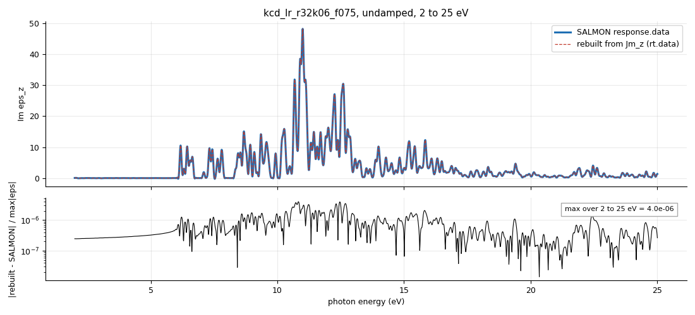

Rebuilt spectra are a method, not a judgment. The undamped rebuild matches SALMON's own
`*_response.data` to 3e-6 to 6e-6 relative on every finished run (below), and a killed run
writes no response file at all
([SALMON-TS-011](../../troubleshooting/SALMON-TS-011-lr-killed-before-response-is-written.md)),
so its spectrum can only come from the printed current. The figure is produced by
[scripts/plot_dt_rebuild_intensity.py](scripts/plot_dt_rebuild_intensity.py)
(`plot_dt_rebuild_intensity.py <data dir> <figure dir>`).

**Damped rebuild (second pass).** `rebuild_damped_spectrum.py` reads `Jm_z` from every step
of `*_rt.data`, applies SALMON's window `1 - 3 x^2 + 2 x^3` (`x` = t over the last time)
and computes `S(omega) = sum_n exp(i omega t_n) Jm_z(t_n) w(t_n) dt`. It does not assume
units: it fits the single complex factor C in `eps_z = 1 + C i S / omega` against SALMON's
own undamped `*_response.data` over 2-25 eV, and prints the largest relative difference
between the undamped rebuild and SALMON's file as the check. It then multiplies the window by
`exp(-t/tau)` and transforms again with the same C. For a run without `*_response.data`, C
is passed from a finished run with the same cell and impulse (`--calib`). Measured: the
check is 3.1e-6 to 5.5e-6 on all eleven finished runs of the ladders (r16 to r32 at k6, k8 to
k24 at r20), and C is the same for all of them to seven digits (9575.53, imaginary part below
0.03).

The representative inputs are
[inputs/diamond-gs-restart-r32k06.inp](inputs/diamond-gs-restart-r32k06.inp) (ground state
with restart data; the ladder ground states differ only in `num_rgrid`, `num_kgrid` and
`nproc_k`),
[inputs/diamond-lr-impulse-r32k06-f075.inp](inputs/diamond-lr-impulse-r32k06-f075.inp)
(response, r32, 75 %),
[inputs/diamond-lr-impulse-r20k20-f075.inp](inputs/diamond-lr-impulse-r20k20-f075.inp)
(response, r20 k20, one rung of the k ladder) and
[inputs/diamond-rt-pulse-r32k06-1e12.inp](inputs/diamond-rt-pulse-r32k06-1e12.inp)
(pulse, 1e12 W/cm^2). They differ from the executed decks in `sysname`, the
pseudopotential path, the restart path and comments. The executed decks read the
ground state through a relative path to the neighboring run directory (`../<ground state>/data_for_restart/`);
the representative decks use `./restart/`, which must hold `info.bin`, `occupation.bin`,
`rho_inout.bin` and `wfn.bin` of the matching ground state. The path SALMON reads is
stored in a 100-character string, so a long absolute path is truncated.

## Observed result

Differences labeled "derived" are computed in this tutorial from the printed values; the absolute values stay next to them. `Im eps_z` differences are the maximum difference in % of the peak of the reference spectrum (shape: after the best rigid shift). `Re eps_z` at 1 eV is a scalar; relative differences are as printed, with the absolute values next to them where printed. The cell has 2 atoms.

### Convergence by observable

A cell names a convergence point only where the [Judgment record](#judgment-record) or the
maintainer's stated judgment holds one (quoted, row in brackets). The other cells give the
measured difference and say "not judged", or "not examined". The ladders are one-variable
studies at different base points: time step at r32 k6 (50 against 75 %), grid at k6, k mesh at
r20 (both at about 75 % of the step limit), and the pulse at r32 k6 with a 50 % step.

| observable | time step | real-space grid (k6) | k mesh (r20) | pulse intensity |
|---|---|---|---|---|
| `Im eps_z`, absorption shape (5 to 25 eV, tau = 10 fs, % of the reference peak after the shift) | 75 % of the limit (maintainer, 2026-10-22, row 1); 50 and 75 % differ by 0.01 % in shape (0.043 % of the peak undamped, 1 to 15 eV) | r20: "r16 can be enough depending on the use; r20 is already quite sufficient" (maintainer, 2026-10-14, row 4); against r32: 4.6 % (r16), 1.0 % (r20), 0.2 % (r24), 0.05 % (r28) | k20 adopted; "k16 is slightly loose, depending on the use" (maintainer, 2026-10-14, row 3); against k24: 10.7 % (k16), 3.5 % (k20), 8.5 % at k20 for tau = 20 fs; k24 is a reference, not converged | not examined |
| `Re eps_z` at 1 eV, as is | not examined | -13.6 % (r16), -3.0 % (r20), -0.7 % (r24), -0.17 % (r28) against r32; the baseline of the current, not the grid (row 12); not judged as grid convergence | within 1 % of k24 from k6 up (row 3); not judged further | not examined |
| `Re eps_z` at 1 eV, baseline subtracted | not examined | r16 to r32 within about 0.1 % of r32 (maintainer, 2026-10-22, row 12) | k12 to k20 within about 0.1 % of k24; k8 0.84 %, k6 1.29 % (maintainer, 2026-10-22, row 12); the statement stops at k20 | not examined |
| excited electrons `N_e` and residual energy at 20 fs | not examined | not examined | not examined | I^3 from 1e11 to 1e13 W/cm^2, slopes 2.96 and 2.99 (maintainer, 2026-10-22, "for now", row 8); one condition |
| `N_h` at 20 fs | not examined | not examined | not examined | at 1e11 at the projection floor, not used (maintainer, 2026-10-22, row 8) |
| energy during the pulse | not examined | not examined | not examined | linear in intensity (exponent 1.03 over 1e11 to 1e13); not judged |

The absorption shape converges slowly in k and fast in r; the adopted point is r = 20 and
k = 20^3. `Re eps_z` below the gap shows no grid dependence and a small k dependence once the
baseline of the post-kick current is subtracted ([section 4](#4-low-frequency-artifact-and-yn_lr_w0_correction)).
The pulse observables were run at one grid, one mesh and one time step only.

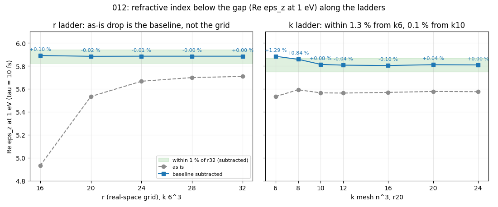

The figure is drawn by [scripts/plot_re_eps_ladders.py](scripts/plot_re_eps_ladders.py)
(`plot_re_eps_ladders.py <figure dir> <path to ladder-script-output.txt>`) from the baseline table in
[provenance/ladder-script-output.txt](provenance/ladder-script-output.txt).

### 1. Time step (k6, 32^3)

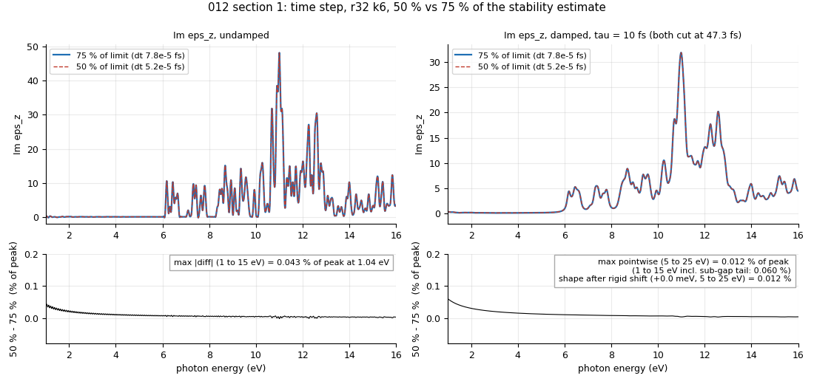

| fraction of the estimated limit | dt (fs) | probe, 400 steps | full 50 fs run |
|---|---:|---|---|
| 50 % | 5.2e-5 | stable | killed at 99.0 %, spectrum rebuilt |
| 75 % | 7.8e-5 | stable | finished (official spectrum) |
| 100 % | 1.04e-4 | stable, no growth within 400 steps | not run |

In the probes the current has the same value at equal physical time for the three time
steps (to 6 digits at 0.0208 fs), the electron number is constant to 1e-8 and no value
is non-finite. 400 steps (0.02 to 0.04 fs) are far too few to exclude a slow instability
at 100 %; that was not tested.

Pairwise comparison of the two 50 fs runs at k6, `Im eps_z`, undamped (table by energy range in
[Supporting tables](#supporting-tables); largest difference 0.043 % of the peak, at 1.04 eV):

The largest difference is in the empty part of the spectrum (`Im eps_z` of about 0.2
there, an absolute difference of 0.02). It is not the truncation of the killed run: with
both series cut at the same time it is 0.037 %, and the rebuild error is 0.004 %. Where the
spectrum is not empty the two time steps agree to 0.01 % (0.007 % over 5-10 eV with the
matched cut). With the damping of section 5 (tau = 10 fs, both series cut at 47.3 fs), the
pair differs by 0.01 % pointwise and in shape, with no shift. The time-step ladder has two
members; it was not run at 25 % (the pre-run estimate was 11.6 h at 27 nodes) and the
pulse was not repeated at another time step. The ladder runs of the second pass used about
75 % of the estimate at each grid; the comparison of two fractions was made at r32 only.

**Judgment.** 75 % of the estimated limit for the response, confirmed as proposed by the AI assistant by the maintainer (2026-10-22), [row 1](#judgment-record). The one pair compared (50 and 75 % at r32 k6) differs by 0.043 % of the peak undamped and 0.01 % in shape damped; 100 % was stable for 400 steps only and 25 % was not run.

### 2. First look: the r32 spectrum (k6, 75 %, official, undamped)

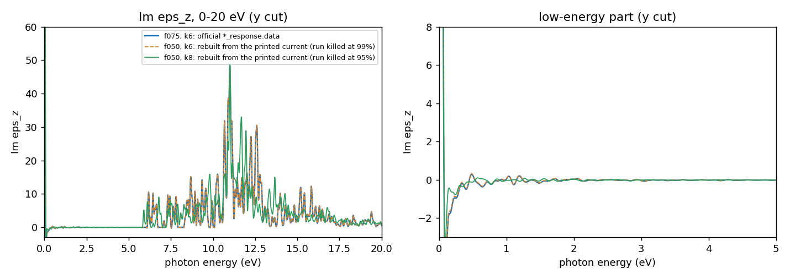

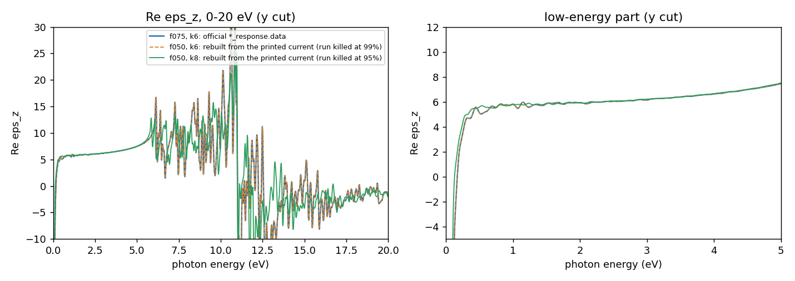

The three curves are: official `*_response.data` of the 75 % run at k6 (blue, partly under
the dashed curve), the 50 % run at k6 and at k8, both **rebuilt from the printed current
(run killed at 99 % / 95 %)**. In the figures the y axis is cut; the low-frequency spike
is outside it.

- `Im eps_z` is empty (|value| < 0.3) from 1 to 5 eV and rises at 6.1 eV. The largest
  peak is 48.3 at 11.00 eV; there are further lines near 12.5 eV (about 30) and 6-10 eV.
  The onset is the lowest vertical transition on this k mesh; the gap printed by the ground
  state is a different, smaller number and is not compared here.
- `Re eps_z` is flat at 5.8 to 5.9 over 1 to 2 eV (mean 5.808, 5.475 to 5.963; with the
  baseline of the current subtracted, section 4: mean 5.897, 5.630 to 6.097) and is
  5.84 at 1.5 eV (as is). Its value at 0.5 eV (5.11; 5.83 with the baseline subtracted) is still affected by the
  low-frequency artifact of section 4. The first-pass reading of the plateau is 5.808 as is and
  5.897 with the baseline subtracted (the static value of this model, about 5.81 at 1 eV
  with the baseline subtracted, is in row 6 of the Judgment record); it is not a converged diamond value: the spectrum is for
  one coarse k mesh.
- The lines are narrow because the k mesh is coarse and the current is undamped (the
  current at the end of the 50 fs run is still about 10 % of its initial value). This is
  the situation of
  [SALMON-TS-012](../../troubleshooting/SALMON-TS-012-undamped-lr-spectrum-is-spiky-with-coarse-k.md).

### 3. First look: k mesh, 6^3 against 8^3 (r32, 50 % time step, undamped)

Figure: the k6 and k8 curves are drawn in `im-eps-z.png` and `re-eps-z.png` of section 2; this pair has no figure of its own.

Both spectra rebuilt from the printed current and from the series cut at the shorter stop time
(47.37 fs):

| range (eV) | max diff (% of the k8 peak) | where (eV) |
|---|---:|---:|
| 1 to 5 (empty) | 0.62 | 1.19 |
| 5-10 | 32.4 | 9.80 |
| 10-15 | 48.2 | 11.65 |

The largest peak is 48.26 at k6 and 48.92 at k8 (+1.4 %), both at 11.0 eV. The `Re eps_z`
plateau (1-2 eV mean) is 5.808 at k6 and 5.837 at k8 (+0.5 %) and its spread narrows
(5.47 to 5.96 against 5.74 to 5.97). The 0.6 % below 5 eV is the difference between two
empty spectra and says nothing about convergence; the large differences are the line
positions and heights above 5 eV, which a denser mesh redistributes. The truncation
error of the rebuild (0.04 % of the peak) is about a thousand times smaller than these
differences, so they are the k mesh. With the damping of section 5 the same pair still
differs by 41.5 % in shape (shift +20 meV). Two undamped spectra this different cannot
say how dense the mesh must be, and a grid test at r32 alone would not show whether the
grid matters next to the k mesh. This is why the second pass damps the spectra and runs
both ladders.

**Judgment.** None from this pair: the maintainer's k judgment ([row 3](#judgment-record)) rests on the damped ladder of section 7.

### 4. Low-frequency artifact and `yn_lr_w0_correction`

Below about 0.1 eV the default analysis gives a large spurious value: `Im eps_z` = 646 at
0.01 eV and -5.6 at 0.1 eV, `Re eps_z` = -150 at 0.01 eV and -14 at 0.1 eV (official
file). With the option `yn_lr_w0_correction = 'y'` (namelist `&analysis`; acts only for a
periodic system with fixed occupations) the window-weighted mean of the current is removed
before the transform. We checked it **offline**, on the printed current of the finished
75 % run, with the same rebuild: `Im eps_z` at 0.01 eV goes from 646 to -1.0 and
`Re eps_z` from -150 to -0.6 (-0.61); the peak is unchanged (48.2636 against 48.2634; max
difference 0.005 % of the peak over 1-15 eV). The ringing of the undamped response
remains: `Re eps_z` is 5.5 at 0.1 eV against 5.9 on the corrected plateau, and the 1-2 eV
mean changes from 5.808 to 5.897 (1.5 %). The static value (about 5.81 at 1 eV, row 6) therefore depends on this
analysis choice at the 1 to 2 % level. The option was **not** used in any SALMON run of this
tutorial.

**The same baseline moves the 1 to 2 eV values of the ladders.** After the kick, `Jm_z` does not
return to zero: averaged over its oscillations it settles at a constant baseline d, the
window-weighted mean that `yn_lr_w0_correction = 'y'` subtracts, d = sum J_n w_n / sum w_n with
w_n = 1 - 3 x^2 + 2 x^3 and x = n / N. d is 1.8e-4 to 9.9e-4 of the largest `|Jm_z|`
(r16 9.9e-4, r20 3.6e-4, r24 2.2e-4, r28 1.9e-4, r32 1.8e-4 at k6; 2.4e-4 for k16 to k24 at
r20). An 8 fs Hann running mean of `Jm_z` over 30 to 46 fs is flat at this value (r20 k24
2.42e-4 to 2.47e-4), so it is a baseline and not leakage of the oscillations (left panel
below). Because eps = 1 + C i S(omega) / omega, a constant in the current adds a term
proportional to 1/omega and lowers `Re eps_z` at low energy. Damped (tau = 10 fs) `Re eps_z`
at 1 eV, as is and with d subtracted: r16 4.932 and 5.890, r20 5.533 and 5.883, r24 5.666 and
5.884, r28 5.698 and 5.884, r32 5.708 and 5.884 (k6); at r20, k8 5.592 and 5.857, k12 5.563 and
5.806, k16 5.569 and 5.803, k20 5.577 and 5.810, k24 5.575 and 5.808. At 2 eV the change is
about 1 % (4.2 % at r16 and 0.75 % at r32); at 5 eV it is 0.1 to 0.2 % (0.5 % at r16); the
shapes above 5 eV are unaffected. The r dependence of `Re eps_z` at 1 eV in section 6 is
this baseline, not grid convergence.

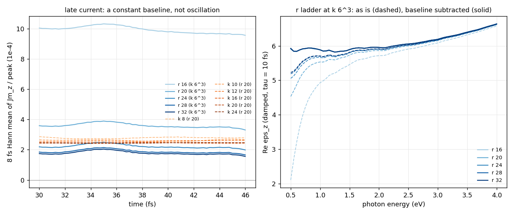

**Recommendation.** Whenever a static or below-gap value is read, set
`yn_lr_w0_correction = 'y'` in the response run, or subtract the baseline offline as in
`scripts/rebuild_damped_spectrum.py --subtract-baseline`, and check the smoothed late current
first. The correction was not used in any SALMON run here; the numbers above are the same
transform applied offline. The mechanism for Si is described in
[SALMON-TS-008](../../troubleshooting/SALMON-TS-008-lr-spectrum-depends-on-propagation-time.md).

### 5. Damping and how to compare two spectra

The second pass compares spectra rebuilt with SALMON's window times `exp(-t/tau)`:

- **Why damp.** An undamped 50 fs spectrum resolves the individual transitions of a coarse
  k mesh as lines about 0.08 eV apart (2 pi hbar over 50 fs). A damping of tau = 10 fs
  broadens every line to a width hbar/tau = 0.066 eV, which is the resolution of the
  comparison. It hides the line-by-line differences between meshes but not a difference in
  the distribution of absorption, which is what is converged in k
  ([SALMON-TS-012](../../troubleshooting/SALMON-TS-012-undamped-lr-spectrum-is-spiky-with-coarse-k.md)).
  tau = 5 fs (0.13 eV) and 20 fs (0.033 eV) are checks of how the k conclusion depends on the
  resolution.
- **Calibration.** The undamped rebuild matches SALMON's own `*_response.data` to 3e-6 to
  6e-6 relative over 2-25 eV on every finished ladder run (Procedure), so the damped
  spectra differ from SALMON's only by the damping.
- **Why shift and shape.** On the steep flanks of the 11 eV peak a rigid shift of a few meV
  gives a pointwise difference of a few percent
  ([SALMON-TS-013](../../troubleshooting/SALMON-TS-013-pointwise-difference-overstates-a-small-shift.md)).
  The shift (meV) says how far the spectrum moves; the shape (% of the reference peak, after
  the shift) says how much it changes otherwise. The pointwise maximum is given as well.
  `Re eps_z` at 1 eV, below the absorption onset, stands for the refractive index below the
  gap; it is read as is and with the baseline of the current subtracted (section 4). The comparison range is 5-25 eV, where `Im eps_z` is not empty.
- With the damping `Im eps_z` is not exactly zero below the onset (at most 0.33 at 1-5 eV
  for r32 k6, the tail of the broadened lines), and the damped `Re eps_z` at 1 eV (5.708 for
  r32 k6 as is) is lower than the undamped plateau of section 2 (5.84 at 1.5 eV, as is); with the baseline subtracted the damped value is 5.884, higher than that as-is plateau value. Compare like with like. Only damped
  spectra with the same tau and the same 50 fs length are compared with each other.

### 6. Grid ladder, r16 to r32 (k 6^3, about 75 % of the limit at each r)

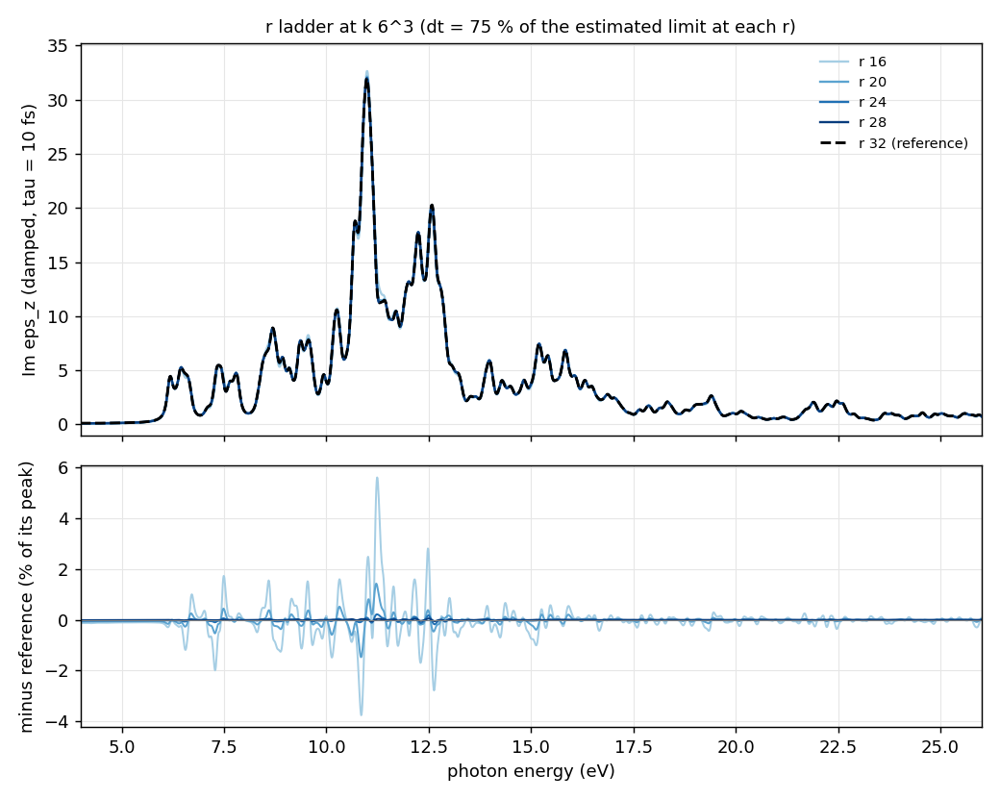

One table; each row is a neighbor pair. `Re eps_z` differences are absolute and derived
(later rung minus earlier rung, from the absolute values printed in section 4). The neighbor-pair
differences of the `Im eps_z` shape were not computed: the ladder script compares each rung with
r32 only and the raw outputs are not committed. The last five columns are the measures of the
earlier rung of the pair against the densest rung r32 (tau = 10 fs, 5 to 25 eV; shift, shape and
pointwise in the units given; `Re eps_z` relative to r32); r32 itself is the reference.

| pair | `dt` of the earlier rung (fs) | `Re eps_z` at 1 eV, as is | difference | `Re eps_z` at 1 eV, baseline subtracted | difference | `Im eps_z` shape, pair | earlier rung against r32: shift (meV) | shape (% of peak) | pointwise (% of peak) | `Re eps_z` as is (%) | `Re eps_z` subtracted (%) |
|---|---:|---|---:|---|---:|---|---:|---:|---:|---:|---:|
| r16 to r20 | 3.1e-4 | 4.932 to 5.533 | +0.601 | 5.890 to 5.883 | -0.007 | not computed | -8.5 | 4.6 | 5.6 | -13.6 | +0.10 |
| r20 to r24 | 2.0e-4 | 5.533 to 5.666 | +0.133 | 5.883 to 5.884 | +0.001 | not computed | -2.5 | 1.0 | 1.5 | -3.0 | -0.02 |
| r24 to r28 | 1.4e-4 | 5.666 to 5.698 | +0.032 | 5.884 to 5.884 | 0.000 | not computed | 0.0 | 0.2 | 0.2 | -0.7 | -0.01 |
| r28 to r32 | 1.0e-4 | 5.698 to 5.708 | +0.010 | 5.884 to 5.884 | 0.000 | not computed | 0.0 | 0.05 | 0.05 | -0.17 | 0.00 |

(reference r32: `dt` 7.8e-5 fs, peak 31.98 at 10.99 eV, `Re eps_z` at 1 eV = 5.708 as is, 5.884 with the baseline
subtracted; each rung is subtracted with its own baseline and compared with the subtracted r32)

- The absorption shape converges fast in r: 1 % at r20, 0.2 % at r24. The shifts are at
  most 8.5 meV, so the r16 difference is mostly shape (4.6 of 5.6 %), around the 11 eV peak.
- `Re eps_z` at 1 eV as is, 4.93 at r16, 5.53 at r20, 5.67 at r24, 5.70 at r28, 5.71 at r32, is
  dominated by the baseline of the post-kick current (section 4), which is 9.9e-4 of the peak
  at r16 and 1.8e-4 at r32. With the baseline subtracted the values are 5.890, 5.883, 5.884,
  5.884 and 5.884, so r16 to r32 are within about 0.1 % of r32: the apparent slow convergence in r is not
  grid convergence.
- The grid effect on the shape is about 50 times smaller than the k effect at this mesh
  size: r20 against r32 is 1.0 %, while k6 against k8 is 47.8 % at r20 and 41.5 % at r32
  (48 % undamped at r32, section 3). This was the reason to run the k ladder at r20.

**Judgment.** Maintainer (2026-10-14): "r16 can be enough depending on the use; r20 is already quite sufficient"; **r20 adopted** ([row 4](#judgment-record), row 11). The maintainer did not name a pair at which the change became small. The reading of `Re eps_z` at 1 eV with the baseline subtracted (r16 to r32 within about 0.1 % of r32) is the maintainer's of 2026-10-22 ([row 12](#judgment-record)).

### 7. k ladder, 6^3 to 24^3 (r20, `dt` = 2.0e-4 fs)

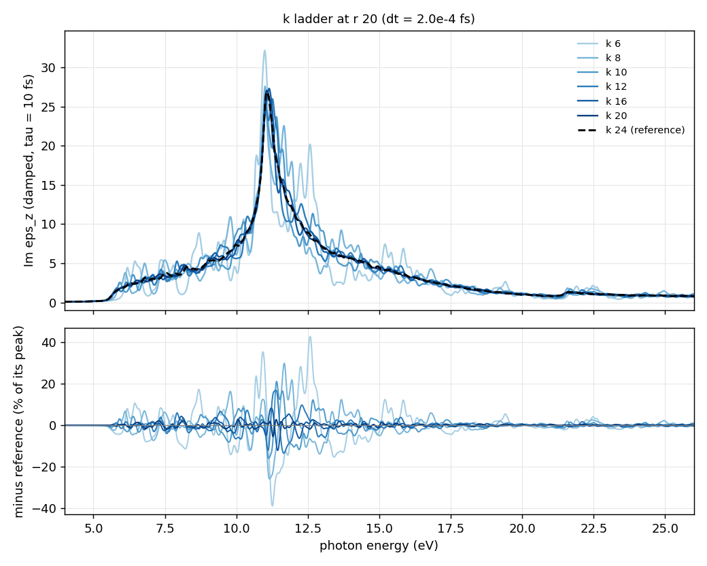

One table; each row is a neighbor pair. `Re eps_z` differences are absolute and derived
(later mesh minus earlier mesh, from the absolute values printed in section 4 and in
[provenance/ladder-script-output.txt](provenance/ladder-script-output.txt); k6 is the r20 k6 run of
section 6). The neighbor-pair differences of the `Im eps_z` shape were not computed: the ladder script
compares each mesh with k24 and k20 only. The last five columns are the measures of the earlier mesh of
the pair against the densest mesh k24 (tau = 10 fs, 5 to 25 eV); k24 itself is the reference.

| pair | `Re eps_z` at 1 eV, as is | difference | `Re eps_z` at 1 eV, baseline subtracted | difference | `Im eps_z` shape, pair | earlier mesh against k24: shift (meV) | shape (% of peak) | pointwise (% of peak) | `Re eps_z` as is (%) | `Re eps_z` subtracted (%) |
|---|---|---:|---|---:|---|---:|---:|---:|---:|---:|
| k6 to k8 | 5.533 to 5.592 | +0.059 | 5.883 to 5.857 | -0.026 | not computed | -24.0 | 42.5 | 43.0 | -0.75 | +1.29 |
| k8 to k10 | 5.592 to 5.565 | -0.027 | 5.857 to 5.813 | -0.044 | not computed | -26.0 | 28.6 | 29.9 | +0.31 | +0.84 |
| k10 to k12 | 5.565 to 5.563 | -0.002 | 5.813 to 5.806 | -0.007 | not computed | -40.5 | 19.1 | 21.2 | -0.19 | +0.08 |
| k12 to k16 | 5.563 to 5.569 | +0.006 | 5.806 to 5.803 | -0.003 | not computed | -32.0 | 14.9 | 16.9 | -0.22 | -0.04 |
| k16 to k20 | 5.569 to 5.577 | +0.008 | 5.803 to 5.810 | +0.007 | not computed | +22.0 | 10.7 | 12.1 | -0.11 | -0.10 |
| k20 to k24 | 5.577 to 5.575 | -0.002 | 5.810 to 5.808 | -0.002 | not computed | +13.5 | 3.5 | 5.5 | +0.04 | +0.04 |

(reference k24: peak 26.82 at 11.07 eV, `Re eps_z` at 1 eV = 5.575 as is, 5.808 with the baseline
subtracted)

Dependence on the damping, shape against k24 (%): table in [Supporting tables](#supporting-tables)
(k12: 10.4, 14.9, 20.9; k16: 5.2, 10.7, 15.7; k20: 1.3, 3.5, 8.5 at tau = 5, 10, 20 fs).

Against k20 as the reference (tau = 10 fs; the reference before k24 was run), the shape is
43.7 % (k6), 29.5 % (k8), 17.8 % (k10), 15.5 % (k12), 12.7 % (k16).

- The shape converges slowly in k: from k12 to k16 the difference to k24 falls only from
  14.9 to 10.7 %, then to 3.5 % at k20. The coarse meshes are lumpy around the 11 eV peak and
  at 12-13 eV (figure); the largest peak goes from 32.1 (k6) to 25.2 (k10) and back to about
  27 from k16 up.
- The shifts are tens of meV with no steady sign; the k difference is a change of shape,
  not a rigid shift.
- The k conclusion depends on the resolution asked for: k20 is 1.3 % from k24 at 0.13 eV,
  3.5 % at 0.066 eV and 8.5 % at 0.033 eV.
- k24 is the reference, not a converged value: the 3.5 % of k20 is a distance between the
  two densest meshes, and k32 was not run.
- `Re eps_z` at 1 eV as is is within 1 % of k24 at every mesh from k6 up (5.53 to 5.59). With
  the baseline subtracted (5.803 to 5.883) it is within 1 % from k8 up (k8 0.84 %, k6 1.29 %)
  and within about 0.1 % of k24 from k10 to k20, and the absolute values are about 4 % higher. The
  refractive index below the gap does not need a dense k mesh.

**Judgment.** Maintainer (2026-10-14): "k16 is slightly loose, depending on the use"; **k20 adopted** ([row 3](#judgment-record), row 11). The maintainer did not name a pair at which the change became small, and k24 is the reference, not a converged value. The reading of `Re eps_z` at 1 eV with the baseline subtracted (k12 to k20 within about 0.1 % of k24; k8 0.84 %, k6 1.29 %) is the maintainer's of 2026-10-22 ([row 12](#judgment-record)).

### 8. Pulse: intensity scaling (k6, 32^3, 50 % time step)

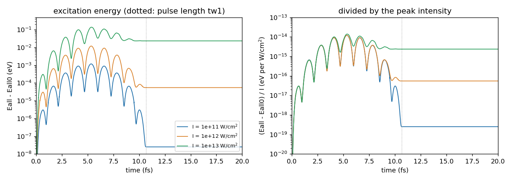

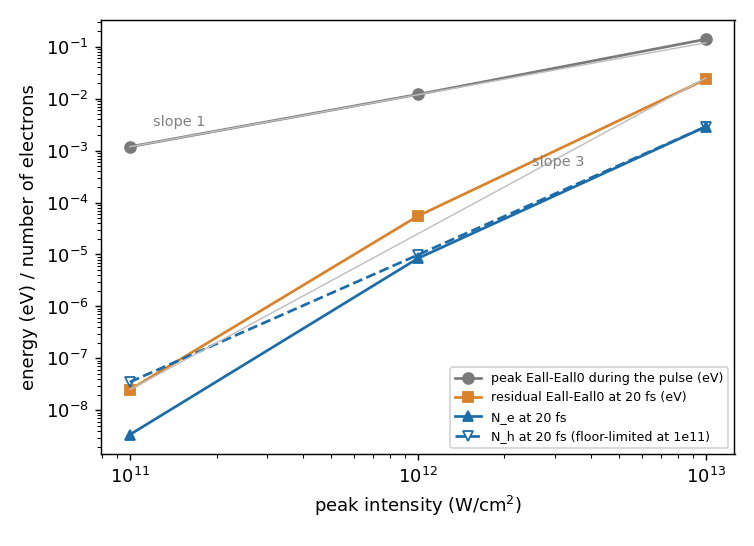

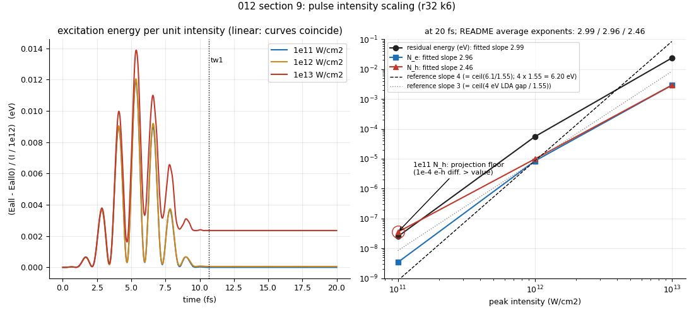

The figure `intensity-scaling.png` is drawn by
[scripts/plot_dt_rebuild_intensity.py](scripts/plot_dt_rebuild_intensity.py).

`Eall - Eall0` is column 3 of `*_rt_energy.data`; the number of excited electrons and holes
(`N_e`, `N_h`) are columns 2 and 3 of `*_nex.data`, written 101 times. In the left panel
of `rt-energy-vs-time.png` the energy rises and falls with the field and then stays at a constant residual after the
pulse (dotted line: `tw1`); in the right panel it is divided by the peak intensity, and
during the pulse the three curves coincide, i.e. the energy is linear in intensity there.

The cell has 2 atoms; the meV/atom columns are derived (eV per cell times 1000, divided by 2).

| I (W/cm^2) | peak Eall-Eall0 (eV), at t | peak (meV/atom, derived) | residual at 20 fs (eV) | residual (meV/atom, derived) | N_e at 20 fs | N_h at 20 fs | residual / N_e (eV) |
|---|---|---:|---:|---:|---:|---:|---:|
| 1e11 | 1.19e-3, 5.34 fs | 0.595 | 2.50e-8 | 1.25e-5 | 3.41e-9 | 3.51e-8 | 7.3 |
| 1e12 | 1.20e-2, 5.34 fs | 6.00 | 5.49e-5 | 2.745e-2 | 8.40e-6 | 9.81e-6 | 6.5 |
| 1e13 | 1.39e-1, 5.36 fs | 69.5 | 2.35e-2 | 11.75 | 2.89e-3 | 2.89e-3 | 8.2 |

Exponents p in (ratio of the quantity) = (ratio of intensities)^p:

| quantity | 1e11 to 1e12 | 1e12 to 1e13 | 1e11 to 1e13 (average) |
|---|---:|---:|---:|
| peak energy during the pulse | 1.01 | 1.06 | 1.03 |
| residual energy at 20 fs | 3.34 | 2.63 | 2.99 |
| N_e at 20 fs | 3.39 | 2.54 | 2.96 |
| N_h at 20 fs | 2.45 | 2.47 | 2.46 |

- The residual is the part of the energy that the system keeps after the field is gone,
  i.e. real excitation. **From 1e11 to 1e13 W/cm^2 the number of excited electrons and the
  absorbed energy scale as I^3** (slopes 2.96 and 2.99), bending towards a lower exponent
  between 1e12 and 1e13 (2.54 and 2.63). This is consistent with three-photon absorption
  across the about 4 eV LDA gap with 1.55 eV photons (three photons are 4.65 eV), so this
  range is perturbative and the excitation can be scaled as I^3 within it. One condition
  only (r32, k6, 50 % time step). The lowest vertical transition on the k6 mesh is 6.1 eV,
  so the slope 3 is not explained by the k6 levels alone; that was not checked at denser k.
- Energy per excited electron is 6.5 to 8.2 eV, between four and five photons of 1.55 eV
  (6.2 and 7.75 eV). This is a reading of the numbers, not a test, and it was not reconciled
  with the three-photon reading.
- At 1e11, `N_h` (3.5e-8) is ten times `N_e` (3.4e-9), and the electron-hole difference
  during the pulse (1e-4) is as large as the numbers themselves. The projection (CG to
  1e-6) is at its resolution there. The ratio residual / `N_e` (7.3 eV) agrees with the
  other two intensities, residual / `N_h` (0.7 eV) does not, so `N_e` and the energy are more
  credible than `N_h` at 1e11 (the dashed curve in `rt-residual-vs-intensity.png`).
- Each run finished all 384700 steps. The electron number printed in the standard output
  is 8.00000000 in every row (resolution 1e-8), no value in `rt.data`, `rt_energy.data`
  or `nex.data` is non-finite, and the current and the energy are flat after the pulse
  (at 1e13 the energy changes by below 1e-4 relative between 12 and 18 fs).
- The pulse was run at r32 and k 6^3 only. Sections 6 and 7 are about the linear response;
  whether the residual energy and `N_e` converge at the same r and k was not tested.

**Judgment.** Maintainer (2026-10-22), confirmed for now as proposed by the AI assistant ([row 8](#judgment-record)): from 1e11 to 1e13 W/cm^2 the number of excited electrons and the absorbed energy scale as I^3 (slopes 2.96 and 2.99), within this perturbative range the excitation can be scaled as I^3; `N_h` at 1e11 is at the projection floor and not used. The pair at which the exponent changes (1e11 to 1e12 against 1e12 to 1e13) was not judged; one condition only.

### 9. Cost

First pass (r32):

| run | nodes (k per process) | steps | elapse used / limit | seconds per step |
|---|---|---:|---|---:|
| response probe, 400 steps | 6 (9) | 400 | 39 s | 0.0698 |
| pulse, 1e12 | 9 (6) | 384700 | 5 h 14 min / 7 h 27 min | 0.049 |
| response, 75 %, k6 | 18 (3) | 641100 | 4 h 53 min / 6 h 13 min | 0.0273 |
| response, 50 %, k6 | 27 (2) | 961600 | killed at 99.0 %, 6 h 13 min / 6 h 13 min | 0.0235 |
| response, 50 %, k8 | 64 (2) | 961600 | killed at 94.7 %, 6 h 13 min / 6 h 13 min | 0.0246 |

(Seconds per step: the probe from SALMON's printed "rt iterations" time over 400 steps, the
pulse and the finished response run from the printed total calculation time over the steps, the two
killed runs from the elapse time over the steps reached, which includes the start-up. The pulse
runs include the periodic projections, so they are not a clean comparison with the response runs.
The 1e11 and 1e13 pulse runs took 5 h 09 min and 5 h 17 min.)

Second pass (50 fs response, all finished; seconds per step = elapse over steps, start-up
included):

| run | nodes (k per process) | steps | elapse | seconds per step | node-hours |
|---|---|---:|---|---:|---:|
| r16, k6 | 6 (9) | 161300 | 21 min | 0.0079 | 2.1 |
| r20, k6 | 6 (9) | 250000 | 66 min | 0.0158 | 6.6 |
| r24, k6 | 6 (9) | 357200 | 2 h 22 min | 0.0238 | 14.2 |
| r28, k6 | 6 (9) | 500000 | 5 h 43 min | 0.0412 | 34.3 |
| r20, k8 | 16 (8) | 250000 | 66 min | 0.0157 | 17.5 |
| r20, k10 | 25 (10) | 250000 | 85 min | 0.0203 | 35.2 |
| r20, k12 | 48 (9) | 250000 | 67 min | 0.0161 | 53.7 |
| r20, k16 | 128 (8) | 250000 | 70 min | 0.0167 | 148.4 |
| r20, k20 | 200 (10) | 250000 | 101 min | 0.0243 | 337.8 |
| r20, k24 | 384 (9) | 250000 | 71 min | 0.0172 | 457.4 |

The number of steps is what makes diamond expensive: the stability limit scales with the
square of the grid spacing, so r = 32 needs 5e-5 to 8e-5 fs where Si at r = 28 used 5e-4 fs.
The cost per step scales with the grid points (r^3): from r16 to r28 at the same nodes and
k-points per process it grows 5.2 times against (28/16)^3 = 5.4. The cost of a run therefore
scales as r^5 at fixed k and length: r16 to r28 is 16.1 times in elapse, (28/16)^5 = 16.4.
The finished r32 run (88 node-hours on 18 nodes) cost about 13 times the r20 run at the same
k (6.6 node-hours), against (32/20)^5 = 10.5. At r20 the whole k ladder up to k24 cost
1.05e3 node-hours, about 12 r32 k6 runs.

Along the k ladder the time per step follows the k-points per process, not the total
number of k-points: at 8 to 10 k-points per process every run took 66 to 101 min, from 6 to
384 nodes. Per k-point per process the time per step is 1.76e-3 s at 6 nodes (k6) and 2 to
38 % more on more nodes (12 % at 16 nodes, 19 % at 128, 38 % at 200, 9 % at 384), so a run
sized from the 6-node rate needs a margin for that. The first pass shows the other side: the
time per step is not proportional to the number of k-points per process when that number
is changed, from 9 to 2 k-points per process it falls only by a factor of three (0.0698 to
0.0235 s) because a part of the step does not shrink. The ladders were therefore kept at
the 8 to 10 k-points per process of the timing probe.

### Recommended settings by use

The acceptable error depends on what the spectrum is used for. The zones below are drawn from
sections 6 and 7 and were **confirmed by the maintainer on 2026-10-22**; they are consistent
with the maintainer's judgment of 2026-10-14 ("r16 can be enough depending on the use; r20 is
already quite sufficient. k16 is slightly loose, depending on the use"). The r zones were
measured at k 6^3 and the k zones at r20 (Assumptions). The refractive index below the gap is
read with the baseline subtracted (section 4).

| use | setting | measure | evidence |
|---|---|---|---|
| refractive index below the gap | r20 k6 (chosen by the maintainer, 2026-10-22) | `Re eps_z` at 1 eV, baseline subtracted | -0.02 % from r32, +1.29 % from k24. Safe: every r from 16 (within about 0.1 % of r32) and every k from 8^3 (within 1 % of k24). Caution: k6 (1.3 % above k24). Not for this use: none established. |
| absorption shape at 0.07 eV resolution (tau = 10 fs) | **r = 20, k = 20^3: the adopted point** (maintainer, 2026-10-14; zones confirmed 2026-10-22), with 75 % of the estimated time-step limit (2.0e-4 fs), 50 fs and the 10 fs damping; input [inputs/diamond-lr-impulse-r20k20-f075.inp](inputs/diamond-lr-impulse-r20k20-f075.inp) | shape after shift, 5 to 25 eV, against r32 and k24 | The run of the k ladder at these settings is the result; no separate confirmation run was made. Shape 3.5 % from k24 (tau = 10 fs) and about 1 % from r32; `Re eps_z` at 1 eV with the baseline subtracted is -0.02 % from r32 (as is it is 3 % below, which is the baseline, section 4). Safe: r >= 20 (1.0 %); k >= 20^3 (3.5 %). Caution: r16 (4.6 %); k16 (10.7 %). Not for this use: k <= 12^3 (14.9 % and more). [Row 11](#judgment-record). |
| finer structure, 0.03 eV resolution (tau = 20 fs) | none | shape after shift, 5 to 25 eV | Safe: none established. Caution: k20 (8.5 %). Not for this use: k <= 16^3 (15.7 % and more); k32 not run. |
| time step of the response | 75 % of the estimated limit (7.8e-5 fs at r32, 2.0e-4 fs at r20), maintainer, 2026-10-22 | shape of the 50 and 75 % pair at r32 k6 | 0.01 % in shape, 0.043 % of the peak undamped; 100 % stable for 400 steps only, 25 % not run. [Row 1](#judgment-record). |
| scaling the excitation with intensity | I^3 from 1e11 to 1e13 W/cm^2, for now (maintainer, 2026-10-22); the pulse condition run is r32, k6 and a 50 % time step | `N_e` and residual energy at 20 fs | Slopes 2.96 and 2.99; one condition only, no ladder; `N_h` at 1e11 not used. [Row 8](#judgment-record). |

## Judgment record

| # | object | conclusion | judged by | what was looked at | reason, including rejected alternatives |
|---|---|---|---|---|---|
| 1 | time step for the response | 75 % of the estimated limit (7.8e-5 fs at r32; about 75 % at every grid of the ladders, 2.0e-4 fs at r20) | maintainer (2026-10-22): confirmed as proposed by the AI assistant | stability probes at 50/75/100 %; pair of full 50 fs runs at 50 % and 75 % at r32 k6, undamped and damped | The pair agrees to 0.043 % of the peak (0.009 % above 5 eV) undamped and to 0.01 % in shape with tau = 10 fs, so 50 % does not change the answer. 100 % was stable for 400 steps only and was not used in production; 25 % was not run (about 11.6 h at 27 nodes by the pre-run estimate). The estimate itself is analytic (it ignores the potential energy); the full runs are the evidence that it is usable. The pair was run at r32 only; the same fraction was carried to r16 to r28, where all runs finished, but no pair of fractions was compared there. |
| 2 | time step for the pulse | 50 % used; not tested against another | assumed by the AI assistant | none (no pulse was repeated at another time step) | The response test suggests that 75 % would do for a pulse too, but the pulse has a different field and a projection; a 75 % pulse run and a 25 % one were planned and not run. |
| 3 | k mesh for the response | ladder k6 to k24 at r20: shape against k24 42.5, 28.6, 19.1, 14.9, 10.7, 3.5 % (k6, k8, k10, k12, k16, k20; tau = 10 fs); `Re eps_z` at 1 eV within 1 % from k6 up as is (from k8 up with the baseline subtracted, row 12). **Adopted k20 (row 11).** | maintainer (2026-10-14): "k16 is slightly loose, depending on the use"; k20 adopted | overlay and difference figure of the damped k ladder; shift, shape, pointwise and `Re eps_z` at 1 eV against k24 and k20; shape at tau = 5, 10, 20 fs | The first pass (k6 and k8 at r32, undamped, 48 % apart) could not show where the mesh converges. The damped ladder shows a slow decrease to k16 and 3.5 % at k20. k20 is safe for the absorption shape at 0.066 eV only if 3.5 % is acceptable; at 0.033 eV it is 8.5 % and no denser mesh than k24 was run (k32 not run), so k24 is a reference, not a converged value. The refractive index below the gap needs no dense mesh. The pulse runs were done at k6 for cost; their numbers are for that mesh. |
| 4 | real-space grid for the response | ladder r16 to r32 at k6: shape against r32 4.6, 1.0, 0.2, 0.05 % (r16, r20, r24, r28); `Re eps_z` at 1 eV -13.6, -3.0, -0.7, -0.17 % as is (+0.10, -0.02, -0.01, 0.00 % with the baseline subtracted, row 12). **Adopted r20 (row 11).** | maintainer (2026-10-06): r = 32 is too strict for the ground state, and the final r depends on the laser conditions; maintainer (2026-10-14): "r16 can be enough depending on the use; r20 is already quite sufficient"; r20 adopted | overlay and difference figure of the damped r ladder; shift, shape, pointwise and `Re eps_z` at 1 eV against r32 | The shape is 1 % at r20, 50 times below the k effect at the same mesh, so r20 serves the absorption shape and was used for the k ladder. `Re eps_z` at 1 eV looked like the slower observable (-3 % at r20, -14 % at r16, as is), so a refractive index below the gap seemed to need r >= 24; that reason is superseded by the baseline finding (row 12, maintainer, 2026-10-22). The ladder was run at k6 only; that the r effect is the same at a dense k mesh is an assumption. The pulse was not run on another grid. |
| 5 | propagation time and window | 50 fs; SALMON's default window, undamped in the first pass; the same window times `exp(-t/tau)` in the second pass | assumed by the AI assistant | none for the length | Not a convergence choice: with the default window the spectrum changes with the length ([SALMON-TS-008](../../troubleshooting/SALMON-TS-008-lr-spectrum-depends-on-propagation-time.md) for Si). 50 fs resolves lines about 0.08 eV apart (2 pi hbar over 50 fs); diamond's undamped current is still about 10 % of its start at the end. Spectra from different lengths or different tau are not compared. |
| 6 | static dielectric constant | value of this model: about 5.81 (`Re eps_z` at 1 eV, tau = 10 fs, baseline of the post-kick current subtracted, r20, k10 to k24: 5.803 to 5.813, within 0.1 % of k24 = 5.808). Its grid independence was measured at k6, where the value is 5.88 (5.883 to 5.890 for r16 to r32, within about 0.1 % of r32); k6 is 1.29 % above k24, k8 0.84 %. The 1 eV value is slightly above the low-frequency limit. Not a converged diamond value. | maintainer (2026-10-22): confirmed as proposed by the AI assistant, reworded as the value of this model at 1 eV | `Re eps_z` at 0.5 to 2 eV with and without the offline `yn_lr_w0_correction`; damped `Re eps_z` at 1 eV along both ladders | The first-pass plateau reading (undamped 1-2 eV mean at r32 k6: 5.808 as is, 5.897 subtracted) moves by 1.5 % with the baseline, and the value at 0.5 eV (5.11 as is) is inside the low-frequency artifact. The value is therefore read at 1 eV with the baseline subtracted, where the ladders show no grid dependence and a small k dependence (row 12). |
| 8 | intensity scaling and the hole number at 1e11 | from 1e11 to 1e13 W/cm^2 the number of excited electrons and the absorbed energy scale as I^3 (slopes 2.96 and 2.99), consistent with three-photon absorption across the about 4 eV LDA gap with 1.55 eV photons; this range is perturbative and the excitation can be scaled as I^3 within it; `N_h` at 1e11 is at the projection floor and not used | maintainer (2026-10-22): confirmed for now as proposed by the AI assistant | energy, `N_e`, `N_h` at three intensities (table and exponents in section 8) | One condition only (r32, k6, 50 % time step). The lowest vertical transition on the k6 mesh is 6.1 eV, so the slope 3 is not explained by the k6 levels alone; not checked at denser k. `N_h` is ten times `N_e` at 1e11 and the energy per hole is inconsistent with the other two intensities, so it is not used. The energy per excited electron (6.5 to 8.2 eV) was not reconciled with the three-photon reading. Which multiphoton channel dominates was not tested. |
| 9 | damping and comparison metric | tau = 10 fs (0.066 eV) as the main damping, 5 and 20 fs as checks; shift and shape after shift over 5-25 eV against the densest rung, plus `Re eps_z` at 1 eV and the pointwise maximum | maintainer (2026-10-22): confirmed as proposed by the AI assistant | undamped and damped overlays; the k conclusion at three tau | Undamped spectra on coarse meshes differ line by line and cannot be ranked ([SALMON-TS-012](../../troubleshooting/SALMON-TS-012-undamped-lr-spectrum-is-spiky-with-coarse-k.md)). A pointwise maximum alone mixes a shift with a shape change ([SALMON-TS-013](../../troubleshooting/SALMON-TS-013-pointwise-difference-overstates-a-small-shift.md)); here the k shifts are tens of meV and the shape dominates, so the two agree within a few %. The k conclusion depends on tau (k20: 1.3, 3.5, 8.5 % at 5, 10, 20 fs), so the resolution of the downstream use must be stated with the zone. |
| 10 | zones by use | as in [Recommended settings by use](#recommended-settings-by-use); chosen r20 k6 for the refractive index below the gap (`Re eps_z` at 1 eV, baseline subtracted) and r20 k20 for the absorption shape (`Im eps_z`, tau = 10 fs; the adopted point) | maintainer (2026-10-22): zones confirmed; r20 k6 for the refractive index below the gap, r20 k20 for the absorption shape | the r and k ladders, sections 6 and 7 | The r zones come from k6 and the k zones from r20; a combination was not run. The caution zone is where the difference is a few % (r) or about 10 % (k) and may or may not matter for the use. The zones use the baseline-subtracted `Re eps_z` (row 12). |
| 11 | adopted (r, k) | r = 20, k = 20^3 (75 % time step, 50 fs, tau = 10 fs); no separate confirmation run | maintainer (2026-10-14) | sections 6 and 7 and Recommended settings by use | The existing k-ladder run at r20 k20 is the adopted result. Alternatives offered and not taken: a confirmation run at r24 k20 (about 8e2 node-hours) and stating no adopted value. Known errors are stated in Recommended settings by use. |
| 12 | low-energy `Re eps_z` and the baseline of the post-kick current | `Re eps_z` at 1 eV must be read with the baseline of `Jm_z` subtracted (or `yn_lr_w0_correction = 'y'`); then r16 to r32 are within about 0.1 % of r32 and k12 to k20 within about 0.1 % of k24 (k8 0.84 %, k6 1.29 %); the as-is r dependence of the 1 eV value is the baseline, and the as-is k dependence is mostly baseline too; a residual k dependence remains with it subtracted (k6 1.29 %, k8 0.84 % against k24) | maintainer (2026-10-22): confirmed as proposed by the AI assistant | baseline d of every ladder run (1.8e-4 to 9.9e-4 of the peak of `Jm_z`); 8 fs Hann running mean of `Jm_z` over 30 to 46 fs; `Re eps_z` at 1, 2 and 5 eV and 0.5 to 4 eV, as is and subtracted | The running mean is flat at the same value as d, so it is a baseline and not leakage of the oscillations. It is the constant that SALMON removes with `yn_lr_w0_correction = 'y'`; the subtraction here is offline, not a SALMON run. Supersedes the 1 eV reason of rows 3, 4, 6 and 10 and of the Recommended settings by use table; the adopted point (row 11) is not changed. k32 was not part of the ladder script output, so the k statement stops at k20. |

Row 7 (rebuilt spectra) is not a judgment; it moved to [Procedure](#procedure) and its number is not reused.

## Assumptions made by the assistant

These were fixed by the drafting assistant, not varied, and are not convergence results.

- The lattice constant a = 3.567 Angstrom is the experimental value, not an LDA-relaxed one.
- The primitive 2-atom cell with the atoms at (0.05, 0.05, 0.05) and (0.30, 0.30, 0.30) in
  reduced coordinates, as in the ground-state tutorial; the displacement of the atoms from
  grid points was not tested.
- FHI98PP LDA with 4 valence electrons and no nonlinear core correction, `xc = 'PZ'`; no other
  pseudopotential or functional.
- `nstate` = 8 (four occupied and four empty bands). SALMON propagates the empty bands too;
  the Si tutorial found the response independent of `nstate`, which was not tested here,
  and the excited-electron projection needs the empty bands.
- Fixed occupations, no symmetry reduction, k mesh on the reciprocal primitive axes with the
  half-shifted Monkhorst-Pack mesh (SALMON's default, `yn_gamma_centered = 'n'`), even meshes
  only, and the same mesh in the ground state and the time-dependent run.
- Polarization along z only; impulse strength is SALMON's default (1e-2 atomic units).
- Analysis grid 3000 points of 0.01 eV (30 eV).
- The r and k effects are separable: the grid ladder was run at k 6^3 and the k ladder at
  r20; no combination of a fine grid and a dense mesh was run.
- The time step as a fraction of an analytic estimate of the stability limit (potential energy
  ignored), about 75 % at every grid of the ladders; the 50 / 75 % comparison was made at r32.
- Damping: `exp(-t/tau)` on top of SALMON's window, tau = 10 fs as the main choice; the
  comparison range 5-25 eV, the densest rung as the reference and the peak of the reference as
  the scale of the percentages (first pass: 1-15 eV and the finer rung).
- Pulse: 1.55 eV, `tw1` = 10.672 fs (the value of the official sample), total 20 fs (about
  9 fs of ringdown), `Acos2` envelope, intensities 1e11, 1e12 and 1e13 W/cm^2; the number of
  excited electrons by projection on the ground-state orbitals, 101 times.
- The ground-state convergence settings (`ncg = 4`, `nscf = 800`, `threshold = 1d-9`, Broyden
  mixing with the defaults) were those of the ground-state tutorial.

## Validation

- Every run was checked for the right number of steps and finite output. First pass: full scans
  of `rt.data`, `rt_energy.data`, `nex.data` and `response.data` where written, a constant
  electron number (8.00000000 in the standard output) and no growth of the current after
  the pulse or the impulse. The finished r32 response run prints 8.0000000000 electrons in all
  64110 rows, and its largest current falls from 0.155 in the first tenth of the run to 0.0155
  in the last tenth (units of `rt.data`). Second pass: every ladder run reached its last step
  and wrote `*_response.data`; a full scan of `rt.data`, `rt_energy.data` and `response.data`
  found no non-finite value; after the kick the total energy stayed constant within 4e-5 eV
  over 50 fs (the kick itself adds 10.9 meV, the same in every run); and the largest `Jm_z`
  fell from 0.155 at the kick to about 1 to 10 % of it in the last tenth of each run (less on
  the denser k meshes), with no growth.
  `tddft_response` prints no electron-number series, so the electron number was not checked
  directly in the second pass.
- A time-dependent run was started only after its ground state had converged and its restart
  files had the exact sizes; the job script also compared the grid, k mesh, `nstate` and the
  cell of the ground state with the deck.
- Controlled comparisons: every deck was checked before submission against one plan
  manifest that pins all keys except the compared variable (time step, grid with its time step,
  k mesh, intensity).
- The rebuild from the printed current (first pass) and the damped rebuild from `*_rt.data`
  (second pass) were validated against SALMON's own `*_response.data` (see Procedure).
- The excitation numbers (`N_e`, `N_h`) at 1e11 are at the resolution of the projection (see
  section 8).
- **Transverse current.** A z impulse drives `Jm_x` = `Jm_y`, with an rms of about half that of
  `Jm_z` after the kick. This is the even, half-shifted k mesh on the fcc primitive cell: it
  keeps only the 12 of the 48 cubic operations that fix the [111] axis, so the conductivity has
  the form `a I + b n n^T` with n along [111], and a z field drives `(b/3)(1, 1, 1)` on top of
  `a z`. `sigma_zz = a + b/3` is the trace over three, i.e. the cubic average, so `eps_zz` is
  unaffected and is a valid ladder point. The mechanism is described in a separate
  troubleshooting entry on the transverse current of an even offset k mesh in an fcc cell (in
  review). Only `eps_z` is reported.
- **Not validated:** no human has judged the figures beyond the maintainer comments in the
  Judgment record; the maintainer adopted r = 20, k = 20^3 (banner and Judgment row 11). The pulse was run at r32, k6 and one time step only,
  so the intensity exponents and the energy per electron are for that grid and mesh. The time
  step 100 % of the estimate was stable for 400 steps only, and the pair of fractions was
  compared at r32 only. The r and k ladders were run separately (k6 and r20). The k ladder ends
  at k24, which is the reference and is not shown to be converged. `yn_lr_w0_correction = 'y'`
  was not run in SALMON (the baseline subtraction of section 4 is offline). The dependence on the length of the response run, the x and y
  polarizations, odd or Gamma-centered meshes, other pseudopotentials and other materials were
  not examined.

### Supporting tables

Section 1: pairwise comparison of the two 50 fs runs (50 % and 75 % of the limit) at r32 k6, `Im eps_z`, undamped, by energy range:

| range (eV) | max diff (% of peak) | where (eV) |
|---|---:|---:|
| 1 to 5 (empty) | 0.043 | 1.04 |
| 5 to 10 | 0.009 | 5.05 |
| 10 to 15 | 0.006 | 10.83 |
| 1 to 15 | 0.043 | 1.04 |

Section 7: dependence of the shape difference on the damping, each k against k24 (%; r20):

| k | tau = 5 fs (0.13 eV) | tau = 10 fs (0.066 eV) | tau = 20 fs (0.033 eV) |
|---|---:|---:|---:|
| 12 | 10.4 | 14.9 | 20.9 |
| 16 | 5.2 | 10.7 | 15.7 |
| 20 | 1.3 | 3.5 | 8.5 |

## Surprises and failures recorded

- **Two 50 fs response runs were killed at the elapse limit and left no spectrum.** The jobs
  were sized by an estimate of 0.0178 s per step (times 1.3) that came from a cost per step
  proportional to the number of k-points per process, extrapolated from a 9 k-points-per-process
  probe to 2 per process. The measured 0.0235 to 0.0246 s per step (1.3 to 1.4 times more)
  used up the whole padding; the run needed about 6 h 17 min (k6) and 6 h 34 min (k8) at the
  measured rate against a limit of 6 h 13 min. SALMON writes `*_response.data` only after the
  last step, so nothing was written. The physics was healthy (electron number constant, no
  non-finite values); the current was in the standard output and the spectra were rebuilt from
  it. About 5.7e2 node-hours produced diagnostics only. This is now
  [SALMON-TS-011](../../troubleshooting/SALMON-TS-011-lr-killed-before-response-is-written.md).
  The ladders of the second pass were kept at the 8 to 10 k-points per process of the timing
  probe, and all of them finished.
- **The low-frequency artifact was as large as for Si** (`Im eps_z` = 646 at 0.01 eV); the
  y axes of the first-pass figures are cut because of it.
- **A constant baseline of 1e-4 to 1e-3 of the peak in the post-kick current shifted `Re eps_z`
  below the gap by 3 to 16 % and mimicked a grid dependence.** The 1 eV value looked like the
  slowest-converging observable in r (-13.6 % at r16); with the baseline subtracted r16 to r32
  are within about 0.1 % of r32 (section 4). It is the same baseline that produces the divergence below
  0.1 eV.
- **The k mesh that serves the ground-state energy does not serve the spectrum**, in the same
  way as in the ground-state tutorial for the DOS: k6 and k8 differ by up to 48 % of the peak
  above 5 eV, and with a 10 fs damping k16 is still 10.7 % from k24.
- **The grid r = 32 suggested by the ground state was far stricter than the absorption shape
  needs** (1 % at r20); the refractive index below the gap looked stricter (-3 % at r20, -0.7 %
  at r24 as is), but that was the baseline of the current, not the grid.
- **A z kick drives an x and y current of half its size** (Validation); it is the k mesh, not a
  fault of the run.
- **At 1e11 W/cm^2 the number of excited holes is ten times the number of electrons**, which
  cannot be physical (electrons and holes are created together). It is the resolution floor of
  the projection.

## Lessons learned

- **The time step of an explicit propagator follows the grid.** Diamond at r = 32 needs a
  step about ten times smaller than Si at r = 28. Estimate the limit from the stencil, test at
  a fraction of it with a short probe, then compare two full-length spectra at different
  fractions.
- **Damp before you compare a ladder.** An undamped spectrum on a coarse k mesh is a set of
  lines that moves from mesh to mesh; damp the current (here tau = 10 fs) and state the
  resolution, because the k answer depends on it.
- **Report a shift and a shape, not only a pointwise maximum.** Where the spectrum moves
  rigidly by a few meV the pointwise number overstates the change; here the r ladder shifts by
  at most 8.5 meV and the k ladder changes shape.
- **Check the smoothed late current before reading low-energy values.** A constant baseline of
  1e-4 to 1e-3 of the peak in the post-kick current lowers `Re eps` below the gap by 3 to 16 %
  and looks like a grid dependence; a running mean of the current over 30 to 46 fs shows it, and
  `yn_lr_w0_correction = 'y'` or an offline subtraction removes it.
- **Compare spectra where they are not empty.** A percentage of the peak in a range where
  `Im eps` is zero says nothing; give differences by energy range and say where the spectrum
  lives.
- **Find out which parameter the observable cares about before converging the expensive one.**
  For this response the absorption shape depends on k far more than on r (50 times at k6 to k8
  against r20 to r32), while `Re eps` below the gap, once the baseline of the current is
  subtracted, depends on r only at the 0.1 % level (r16 to r32) and on k at 1.3 % at k6, 0.8 % at k8 and 0.1 % from k10 (the as-is r dependence is the baseline). A grid ladder at
  a coarse k and a k ladder at a moderate r answer both at a fraction of the r32 cost.
- **The right (r, k) depends on the use.** Give safe and caution zones per observable and
  resolution, and let the person who knows the use choose.
- **Do not size a long run from a rate measured at a different number of k-points per process.**
  The cost per step has a part that does not shrink. Measure the rate at the production shape,
  for example a few hundred steps on the same nodes and k-points per process, and keep a margin
  for more nodes.
- **A killed response run is not lost if the current is on disk.** Rebuild the spectrum with
  the same transform and label it as a diagnostic; check the rebuild on a run that finished.
- **Scale with intensity on the residual, not on the in-pulse energy.** The energy during the
  pulse is linear in intensity (virtual polarization); what is left after the pulse is the
  multiphoton excitation and scales with a high power.

## Limitations and applicability

This tutorial covers one diamond cell at the experimental lattice constant, PZ-LDA, FHI98PP with
4 valence electrons and no core correction, no spin-orbit coupling, `nstate` = 8, SALMON v2.3.0
on Fugaku (A64FX). The linear response was run at 16^3 to 32^3 at k 6^3 and at k 6^3 to 24^3 at
20^3 (plus k 8^3 at 32^3); the pulse at 32^3 and k 6^3 only.

- The response has two members in time step (at r32), five in r (at k6) and seven in k (at r20);
  the pulse has one time step, one grid, one k mesh and three intensities.
- The k mesh is not shown to be converged beyond the k24 reference; the zones of Recommended settings by use are
  for the stated resolutions.
- The numbers (static constant, line positions, excitation per intensity) are for these meshes and
  must not be quoted as properties of diamond.
- The zones are for `eps_z` of the linear response. The pulse observables were not run on the
  ladders and may need a different r or k; the maintainer noted that the grid for the
  time-dependent runs depends on the laser conditions.
- The grid and the time step are costs as much as parameters here; other conditions (for example a
  coarser grid) change both.

## References

- SALMON official samples `exercise_05_bulkSi_lr` and `exercise_06_bulkSi_rt` in the SALMON v2.3.0
  source tree (tag `v.2.3.0`), as the starting point of the decks (translated here to the
  diamond primitive cell).
- [ABINIT LDA FHI pseudopotential collection](https://www.abinit.org/atomic_data/psps/miscellaneous/ATOMICDATA/LDA_FHI/)
- Related tutorials:
  [SALMON-TUTORIAL-010](../010-diamond-gs-convergence-rgrid-kmesh-dos/) (diamond ground state),
  [SALMON-TUTORIAL-009](../009-si-linear-response-convergence-kmesh-rgrid-dt-propagation-time/)
  (Si linear response).
- Related troubleshooting:
  [SALMON-TS-008](../../troubleshooting/SALMON-TS-008-lr-spectrum-depends-on-propagation-time.md)
  (the spectrum depends on the propagation time),
  [SALMON-TS-011](../../troubleshooting/SALMON-TS-011-lr-killed-before-response-is-written.md)
  (a killed run leaves no spectrum),
  [SALMON-TS-012](../../troubleshooting/SALMON-TS-012-undamped-lr-spectrum-is-spiky-with-coarse-k.md)
  (damping),
  [SALMON-TS-013](../../troubleshooting/SALMON-TS-013-pointwise-difference-overstates-a-small-shift.md)
  (shift and shape),
  [TS-002](../../troubleshooting/SALMON-TS-002-printed-gap-depends-on-k-mesh.md); a separate entry
  on the transverse current of an even offset k mesh in an fcc cell is in review.
- Run provenance: [provenance/run.yaml](provenance/run.yaml). Raw outputs are not committed.
